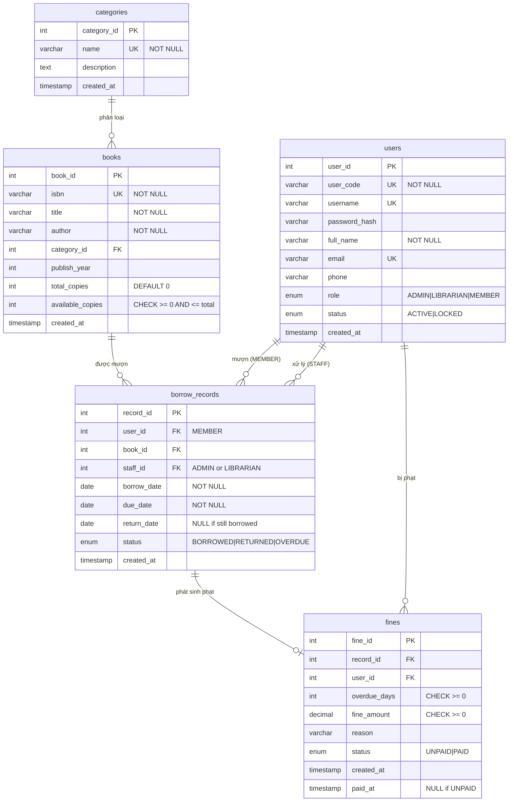

# HỆ THỐNG QUẢN LÝ THƯ VIỆN — LIBRARY MANAGEMENT SYSTEM

> **Học phần:** Lập trình Hướng đối tượng (OOP)  
> **Công nghệ:** Java 17 · JDBC · MySQL 8+ · Apache Maven 3.x  
> **Kiến trúc CSDL:** Single Table Inheritance (bảng `users` làm đỉnh kế thừa)

---

## 1. Mục Đích Dự Án

Ứng dụng **Quản lý Thư viện** được phát triển để quản lý toàn bộ nghiệp vụ mượn/trả sách, quản lý danh mục tài liệu, phân quyền người dùng và xử lý phiếu phạt quá hạn.

Dự án áp dụng kiến trúc phân tầng chuẩn (Layered Architecture):

| Tầng | Package | Trách nhiệm |
| :---: | :--- | :--- |
| **Config** | `com.library.config` | Quản lý kết nối CSDL (Singleton `DatabaseConnection`) |
| **Model** | `com.library.model` | Các lớp thực thể ánh xạ với bảng CSDL |
| **DAO** | `com.library.dao` | Truy xuất và ghi dữ liệu qua JDBC (CRUD) |
| **Service** | `com.library.service` | Nghiệp vụ lõi: kiểm tra tính hợp lệ, tính phí phạt, quản lý transaction |
| **View** | `com.library.view` | Giao diện console tương tác với người dùng (menu CLI) |

---

## 2. Áp Dụng 4 Đặc Trưng Lập Trình Hướng Đối Tượng (OOP)

### 2.1 Encapsulation — Đóng Gói

Mọi trường dữ liệu trong tất cả lớp Model (`User`, `Member`, `Staff`, `Book`, `Category`, `BorrowRecord`, `Fine`) đều được khai báo `private`. Dữ liệu chỉ được đọc/ghi qua `getter`/`setter`, bên trong đó có thể tích hợp logic kiểm tra hợp lệ:

```java
// Ví dụ trong lớp Book.java
private int availableCopies;

public void setAvailableCopies(int availableCopies) {
    if (availableCopies < 0 || availableCopies > this.totalCopies)
        throw new IllegalArgumentException("Số bản sách khả dụng không hợp lệ!");
    this.availableCopies = availableCopies;
}
```

### 2.2 Inheritance — Kế Thừa (Single Table Inheritance)

Thiết kế áp dụng mô hình **Single Table Inheritance (STI)**: lớp trừu tượng `User` là lớp cha, hai lớp con `Member` (Độc giả) và `Staff` (Nhân viên) kế thừa từ `User`.

> **Lý do dùng STI:** Toàn bộ người dùng chia sẻ chung bộ thuộc tính định danh (`fullName`, `email`, `phone`, `status`). STI giúp tránh JOIN phức tạp khi truy vấn đồng thời nhiều loại người dùng, phù hợp với quy mô dự án học tập.

```
         ┌─────────────────────────┐
         │   <<abstract>> User     │   Lớp cha dùng chung
         │  ─────────────────────  │   (ánh xạ với bảng `users`)
         │  - userId: int          │
         │  - userCode: String     │
         │  - fullName: String     │
         │  - email: String        │
         │  - phone: String        │
         │  - role: Role (enum)    │
         │  - status: Status (enum)│
         │  + displayInfo(): void  │   ← phương thức trừu tượng
         │  + hasPermission(): bool│   ← phương thức trừu tượng
         └────────────┬────────────┘
                      │ extends
          ┌───────────┴───────────┐
          │                       │
┌─────────▼─────────┐   ┌─────────▼──────────┐
│      Member       │   │       Staff        │
│  (MEMBER role)    │   │  (ADMIN/LIBRARIAN) │
│ ───────────────── │   │ ────────────────── │
│ - joinDate: Date  │   │ - username: String │
│ + displayInfo()   │   │ - passwordHash:str │
│ + hasPermission() │   │ + displayInfo()    │
└───────────────────┘   │ + hasPermission()  │
                        │ + authenticate()   │
                        └────────────────────┘
```

**Bảng CSDL `users` tương ứng (STI — phân biệt bằng cột `role`):**

| `role` | Ánh xạ lớp Java | Trường đặc thù |
| :--- | :--- | :--- |
| `MEMBER` | `Member extends User` | `user_code` dạng `MBRxxx` |
| `LIBRARIAN` | `Staff extends User` | `username`, `password_hash` |
| `ADMIN` | `Staff extends User` | `username`, `password_hash` |

### 2.3 Polymorphism — Đa Hình

**Đa hình lúc chạy (Runtime Polymorphism):** `Member` và `Staff` đều ghi đè (`@Override`) các phương thức trừu tượng của `User`:

```java
// Member.java
@Override
public void displayInfo() {
    System.out.printf("[ĐỘC GIẢ] %s | Mã thẻ: %s | Trạng thái: %s%n",
        getFullName(), getUserCode(), getStatus());
}

// Staff.java
@Override
public void displayInfo() {
    System.out.printf("[NHÂN VIÊN - %s] %s | Tài khoản: %s%n",
        getRole(), getFullName(), getUsername());
}
```

**Đa hình lúc biên dịch (Compile-time / Overloading):** Các phương thức tìm kiếm trong tầng `Service` được nạp chồng linh hoạt:

```java
// BookService.java
public List<Book> findBooks(String keyword)          { ... }
public List<Book> findBooks(int categoryId)          { ... }
public List<Book> findBooks(String keyword, int catId) { ... }
```

### 2.4 Abstraction — Trừu Tượng

Định nghĩa giao diện `CrudDAO<T, ID>` áp đặt hành vi CRUD chuẩn, tách biệt hoàn toàn định nghĩa khỏi cài đặt JDBC cụ thể:

```java
public interface CrudDAO<T, ID> {
    Optional<T> findById(ID id);
    List<T>     findAll();
    boolean     save(T entity);
    boolean     update(T entity);
    boolean     deleteById(ID id);
}
```

Mỗi bảng có lớp triển khai cụ thể:
- `BookDAOImpl implements CrudDAO<Book, Integer>`
- `UserDAOImpl implements CrudDAO<User, Integer>`
- `BorrowRecordDAOImpl implements CrudDAO<BorrowRecord, Integer>`
- `FineDAOImpl implements CrudDAO<Fine, Integer>`

---

## 3. Cấu Trúc Cây Thư Mục Dự Án

```
LibraryManagementSystem/                        ← Thư mục gốc dự án
├── pom.xml                                     ← Cấu hình Maven (Java 17, mysql-connector-j 8.3.0)
├── README.md                                   ← Tài liệu thiết kế kiến trúc (file này)
│
├── sql/                                        ← Script cơ sở dữ liệu MySQL
│   ├── schema.sql                              ← Tạo library_db và 5 bảng (STI design)
│   └── seed.sql                                ← Dữ liệu mẫu tiếng Việt
│
├── reports/                                    ← Báo cáo tiến độ từng Milestone
│   └── milestone_1_report.md
│
└── src/
    └── main/
        └── java/
            └── com/library/
                ├── config/                     ← DatabaseConnection (Singleton pattern)
                ├── model/                      ← User(abstract), Member, Staff, Book, Category,
                │                               │  BorrowRecord, Fine, Role(enum), Status(enum)
                ├── dao/                        ← CrudDAO<T,ID> interface + *DAOImpl classes
                ├── service/                    ← *Service classes (Business Logic + Transaction)
                └── view/                       ← MainMenu, BookMenu, BorrowMenu (CLI)
```

---

## 4. Thiết Kế Cơ Sở Dữ Liệu `library_db`

**Charset:** `utf8mb4` · **Collation:** `utf8mb4_unicode_ci` · **Engine:** InnoDB



### Bảng 1 — `categories` (Thể loại sách)

| Cột | Kiểu | Ràng buộc | Mô tả |
| :--- | :--- | :--- | :--- |
| `category_id` | `INT` | `PK`, `AUTO_INCREMENT` | Khóa chính định danh thể loại |
| `name` | `VARCHAR(100)` | `NOT NULL`, `UNIQUE` | Tên thể loại |
| `description` | `TEXT` | `NULL` | Mô tả nội dung thể loại |
| `created_at` | `TIMESTAMP` | `DEFAULT NOW()` | Thời điểm tạo bản ghi |

### Bảng 2 — `books` (Thông tin đầu sách)

| Cột | Kiểu | Ràng buộc | Mô tả |
| :--- | :--- | :--- | :--- |
| `book_id` | `INT` | `PK`, `AUTO_INCREMENT` | Khóa chính định danh sách |
| `isbn` | `VARCHAR(20)` | `NOT NULL`, `UNIQUE` | Mã ISBN quốc tế |
| `title` | `VARCHAR(255)` | `NOT NULL` | Tiêu đề sách |
| `author` | `VARCHAR(150)` | `NOT NULL` | Tác giả |
| `category_id` | `INT` | `NOT NULL`, `FK → categories` | Thể loại của sách |
| `publish_year` | `INT` | `NULL` | Năm xuất bản |
| `total_copies` | `INT` | `NOT NULL`, `DEFAULT 0` | Tổng số bản sách thư viện sở hữu |
| `available_copies` | `INT` | `NOT NULL`, `CHECK >= 0 AND <= total` | Số bản còn sẵn để mượn |
| `created_at` | `TIMESTAMP` | `DEFAULT NOW()` | Thời điểm thêm sách |

### Bảng 3 — `users` (Người dùng — Single Table Inheritance)

| Cột | Kiểu | Ràng buộc | Mô tả |
| :--- | :--- | :--- | :--- |
| `user_id` | `INT` | `PK`, `AUTO_INCREMENT` | Khóa chính định danh người dùng |
| `user_code` | `VARCHAR(20)` | `NOT NULL`, `UNIQUE` | Mã nghiệp vụ (`ADMxxx`, `LIBxxx`, `MBRxxx`) |
| `username` | `VARCHAR(50)` | `UNIQUE`, `NULL` | Tên đăng nhập (chỉ ADMIN và LIBRARIAN) |
| `password_hash` | `VARCHAR(255)` | `NULL` | Mật khẩu băm SHA-256 |
| `full_name` | `VARCHAR(100)` | `NOT NULL` | Họ tên đầy đủ |
| `email` | `VARCHAR(100)` | `UNIQUE`, `NULL` | Địa chỉ email |
| `phone` | `VARCHAR(20)` | `NULL` | Số điện thoại |
| `role` | `ENUM` | `NOT NULL`, `DEFAULT 'MEMBER'` | `'ADMIN'` · `'LIBRARIAN'` · `'MEMBER'` |
| `status` | `ENUM` | `NOT NULL`, `DEFAULT 'ACTIVE'` | `'ACTIVE'` (Hoạt động) · `'LOCKED'` (Bị khóa) |
| `created_at` | `TIMESTAMP` | `DEFAULT NOW()` | Thời điểm đăng ký tài khoản |

> **Ghi chú thiết kế STI:** Phân biệt loại người dùng qua cột `role`. Khi `role = 'MEMBER'`, cột `username` và `password_hash` để `NULL`. Tầng DAO sẽ ánh xạ kết quả truy vấn thành đối tượng `Member` hoặc `Staff` tương ứng dựa trên giá trị `role`.

### Bảng 4 — `borrow_records` (Phiếu mượn / trả sách)

| Cột | Kiểu | Ràng buộc | Mô tả |
| :--- | :--- | :--- | :--- |
| `record_id` | `INT` | `PK`, `AUTO_INCREMENT` | Khóa chính mã phiếu mượn |
| `user_id` | `INT` | `NOT NULL`, `FK → users` | Độc giả thực hiện mượn (role = MEMBER) |
| `book_id` | `INT` | `NOT NULL`, `FK → books` | Đầu sách được mượn |
| `staff_id` | `INT` | `NOT NULL`, `FK → users` | Nhân viên duyệt phiếu (role = ADMIN/LIBRARIAN) |
| `borrow_date` | `DATE` | `NOT NULL` | Ngày mượn |
| `due_date` | `DATE` | `NOT NULL` | Hạn trả sách |
| `return_date` | `DATE` | `NULL` | Ngày thực tế trả (`NULL` nếu chưa trả) |
| `status` | `ENUM` | `NOT NULL`, `DEFAULT 'BORROWED'` | `'BORROWED'` · `'RETURNED'` · `'OVERDUE'` |
| `created_at` | `TIMESTAMP` | `DEFAULT NOW()` | Thời điểm tạo phiếu |

### Bảng 5 — `fines` (Phiếu phạt quá hạn)

| Cột | Kiểu | Ràng buộc | Mô tả |
| :--- | :--- | :--- | :--- |
| `fine_id` | `INT` | `PK`, `AUTO_INCREMENT` | Khóa chính mã phiếu phạt |
| `record_id` | `INT` | `NOT NULL`, `FK → borrow_records` | Phiếu mượn phát sinh vi phạm |
| `user_id` | `INT` | `NOT NULL`, `FK → users` | Độc giả bị phạt (dư thừa có chủ ý để truy vấn nhanh) |
| `overdue_days` | `INT` | `NOT NULL`, `CHECK >= 0` | Số ngày quá hạn |
| `fine_amount` | `DECIMAL(12,2)` | `NOT NULL`, `CHECK >= 0` | Số tiền phạt (VNĐ) |
| `reason` | `VARCHAR(255)` | `NULL` | Lý do phạt (mô tả tự do) |
| `status` | `ENUM` | `NOT NULL`, `DEFAULT 'UNPAID'` | `'UNPAID'` (Chưa đóng) · `'PAID'` (Đã đóng) |
| `created_at` | `TIMESTAMP` | `DEFAULT NOW()` | Thời điểm lập phiếu phạt |
| `paid_at` | `TIMESTAMP` | `NULL` | Thời điểm đóng phạt (`NULL` nếu chưa đóng) |

---

## 5. Hướng Dẫn Khởi Chạy Dự Án

```bash
# 1. Khởi tạo CSDL
mysql -u root -p < sql/schema.sql
mysql -u root -p < sql/seed.sql

# 2. Kiểm tra biên dịch
mvn clean compile

# 3. Chạy ứng dụng (Milestone tiếp theo)
mvn exec:java -Dexec.mainClass="com.library.Main"
```
