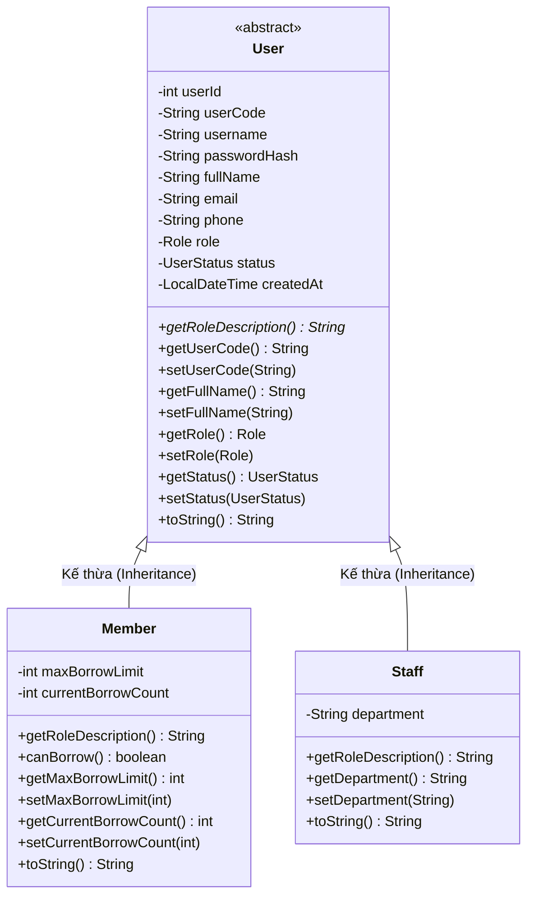

# BÁO CÁO KẾT QUẢ THỰC HIỆN MILESTONE 2: CONFIG & MODEL OOP

- **Dự án:** Hệ thống Quản lý Thư viện (Library Management System)
- **Học phần:** Lập trình Hướng đối tượng (Java + MySQL)
- **Đường dẫn thư mục dự án:** `/Users/apple/Documents/LibraryManagementSystem`
- **Ngày thực hiện:** 18/10/2026
- **Trạng thái tổng thể:** ✅ HOÀN THÀNH 100% (Đúng phạm vi chỉ thực hiện `config` và `model`)

---

## 1. Bảng Kiểm Tra Tiến Độ Các Hạng Mục (Checklist)

| STT | Tên file / Hạng mục | Vị trí package | Trạng thái | Ghi chú kỹ thuật |
| :---: | :--- | :--- | :---: | :--- |
| 1 | `DatabaseConfig.java` | `com.library.config` | **HOÀN THÀNH** | Utility Pattern (private constructor), quản lý URL, user, pass linh hoạt qua biến môi trường, cung cấp `getConnection()` và `testConnection()` |
| 2 | `Role.java` | `com.library.model` | **HOÀN THÀNH** | Enum tương ứng ENUM('ADMIN', 'LIBRARIAN', 'MEMBER') |
| 3 | `UserStatus.java` | `com.library.model` | **HOÀN THÀNH** | Enum tương ứng ENUM('ACTIVE', 'LOCKED') |
| 4 | `BorrowStatus.java` | `com.library.model` | **HOÀN THÀNH** | Enum tương ứng ENUM('BORROWED', 'RETURNED', 'OVERDUE') |
| 5 | `FineStatus.java` | `com.library.model` | **HOÀN THÀNH** | Enum tương ứng ENUM('UNPAID', 'PAID') |
| 6 | `User.java` | `com.library.model` | **HOÀN THÀNH** | Abstract class đại diện bảng `users` (STI), phương thức trừu tượng `getRoleDescription()`, 10 thuộc tính private |
| 7 | `Member.java` | `com.library.model` | **HOÀN THÀNH** | Kế thừa `User`, bổ sung `maxBorrowLimit`, `currentBorrowCount`, phương thức `canBorrow()`, override `getRoleDescription()` |
| 8 | `Staff.java` | `com.library.model` | **HOÀN THÀNH** | Kế thừa `User`, bổ sung `department`, override `getRoleDescription()` phân biệt ADMIN và LIBRARIAN |
| 9 | `Category.java` | `com.library.model` | **HOÀN THÀNH** | Entity thể loại sách (categoryId, name, description) |
| 10 | `Book.java` | `com.library.model` | **HOÀN THÀNH** | Entity đầu sách, tiện ích `isAvailable()`, ràng buộc `availableCopies <= totalCopies` |
| 11 | `BorrowRecord.java` | `com.library.model` | **HOÀN THÀNH** | Entity phiếu mượn/trả, kiểm tra logic `dueDate` không trước `borrowDate` |
| 12 | `Fine.java` | `com.library.model` | **HOÀN THÀNH** | Entity phiếu phạt, kiểu tiền tệ `BigDecimal`, phương thức `markAsPaid()`, ràng buộc tiền phạt không âm |
| 13 | `Milestone2Test.java` | `com.library` | **HOÀN THÀNH** | Runner kiểm thử toàn diện kết nối CSDL, đa hình, logic mượn và exception validation |
| 14 | Tuân thủ phạm vi Milestone | Toàn dự án | **TUÂN THỦ** | Không sinh trước mã nguồn cho `dao`, `service`, `view` |

---

## 2. Sơ Đồ Thiết Kế Quan Hệ Kế Thừa & Tính Đa Hình (OOP)

Hệ thống áp dụng mô hình **Single Table Inheritance (STI)** đồng bộ với bảng `users` trong cơ sở dữ liệu `library_db`:



### 2.1. Phân tích 4 đặc trưng OOP được áp dụng:

1. **Encapsulation (Đóng gói):**
   - 100% thuộc tính của tất cả các lớp Entity (`User`, `Member`, `Staff`, `Category`, `Book`, `BorrowRecord`, `Fine`) được đặt ở phạm vi `private`.
   - Mọi truy xuất hoặc cập nhật giá trị đều bắt buộc thông qua hệ thống `getter` / `setter`.
   - Các phương thức `setter` tích hợp cơ chế thẩm định dữ liệu chặt chẽ (throw `IllegalArgumentException` khi dữ liệu không hợp lệ như chuỗi rỗng, số âm, số lượng khả dụng vượt quá tổng số lượng, v.v.).

2. **Inheritance (Kế thừa):**
   - Lớp `User` đóng vai trò là lớp cha trừu tượng gom các thuộc tính dùng chung của toàn bộ người dùng trong thư viện (`userCode`, `fullName`, `email`, `phone`, `role`, `status`, `createdAt`).
   - Lớp con `Member` mở rộng thêm hành vi quản lý mượn trả: hạn mức mượn (`maxBorrowLimit`), số sách đang mượn (`currentBorrowCount`).
   - Lớp con `Staff` mở rộng thêm phòng ban công tác (`department`).

3. **Polymorphism (Đa hình):**
   - **Đa hình lúc chạy (Runtime Polymorphism):** Định nghĩa phương thức trừu tượng `public abstract String getRoleDescription();` tại lớp cha `User`.
     - `Member` ghi đè trả về `"Độc giả thư viện"`.
     - `Staff` ghi đè kiểm tra `Role`: nếu là `ADMIN` trả về `"Quản trị viên"`, nếu là `LIBRARIAN` trả về `"Nhân viên thư viện"`.
     - Khi duyệt qua danh sách `User[] users = new User[] { member, staffAdmin, staffLib };`, JVM tự động gọi đúng phương thức của từng đối tượng con tại thời điểm thực thi.

4. **Abstraction (Trừu tượng):**
   - `User` là lớp trừu tượng (`abstract class`), không cho phép tạo thể hiện trực tiếp thông qua `new User()`, buộc người lập trình phải tạo đúng đối tượng nghiệp vụ cụ thể (`Member` hoặc `Staff`).

---

## 3. Log Kết Quả Biên Dịch Maven (`mvn clean compile`)

```text
[INFO] Scanning for projects...
[INFO] 
[INFO] ----------------< com.library:LibraryManagementSystem >-----------------
[INFO] Building LibraryManagementSystem 1.0.0
[INFO]   from pom.xml
[INFO] --------------------------------[ jar ]---------------------------------
[INFO] Loaded 24127 auto-discovered prefixes for remote repository central (prefixes-central.txt)
[INFO] Loaded 74 auto-discovered prefixes for remote repository apache.snapshots (prefixes-apache.snapshots.txt)
[INFO] 
[INFO] --- clean:3.5.0:clean (default-clean) @ LibraryManagementSystem ---
[INFO] Deleting /Users/apple/Documents/LibraryManagementSystem/target
[INFO] 
[INFO] --- resources:3.5.0:resources (default-resources) @ LibraryManagementSystem ---
[INFO] skip non existing resourceDirectory /Users/apple/Documents/LibraryManagementSystem/src/main/resources
[INFO] 
[INFO] --- compiler:3.13.0:compile (default-compile) @ LibraryManagementSystem ---
[INFO] Recompiling the module because of changed source code.
[INFO] Compiling 13 source files with javac [debug release 17] to target/classes
[INFO] ------------------------------------------------------------------------
[INFO] BUILD SUCCESS
[INFO] ------------------------------------------------------------------------
[INFO] Total time:  1.605 s
[INFO] Finished at: 2026-10-18T17:21:13+07:00
[INFO] ------------------------------------------------------------------------
```
> Kết quả: Biên dịch thành công 13 file nguồn Java với target release Java 17, không có bất kỳ warning hay lỗi nào.

---

## 4. Kết Quả Kiểm Thử Nội Bộ (`Milestone2Test`)

Đã thực thi lớp kiểm thử nội bộ `com.library.Milestone2Test`. Kết quả thực tế hiển thị như sau:

```text
================================================================================
               KIỂM THỬ NỘI BỘ MILESTONE 2: CONFIG & MODEL OOP                   
================================================================================

--- 1. KIỂM TRA TẦNG CẤU HÌNH (DatabaseConfig) ---
==================================================
[DatabaseConfig] Đang kiểm tra kết nối đến MySQL...
URL:  jdbc:mysql://localhost:3306/library_db?useUnicode=true&characterEncoding=UTF-8&serverTimezone=Asia/Ho_Chi_Minh&allowPublicKeyRetrieval=true&useSSL=false
User: root
-> KẾT NỐI CƠ SỞ DỮ LIỆU THÀNH CÔNG!
   Database Name:    library_db
   DBMS Version:     26.7.0
   JDBC Driver Name: MySQL Connector/J
   Driver Version:   mysql-connector-j-8.3.0 (Revision: 805f872a57875f311cb82487efcfb070411a3fa0)
==================================================

--- 2. KIỂM TRA TÍNH KẾ THỪA & ĐA HÌNH (OOP) ---
[Member] Mã: MBR001   | Họ tên: Phạm Minh Tuấn     | Vai trò: MEMBER     | Mô tả đa hình: Độc giả thư viện
[Member] Mã: MBR004   | Họ tên: Vũ Bích Hạnh       | Vai trò: MEMBER     | Mô tả đa hình: Độc giả thư viện
[Staff] Mã: ADM001   | Họ tên: Nguyễn Quản Trị    | Vai trò: ADMIN      | Mô tả đa hình: Quản trị viên
[Staff] Mã: LIB001   | Họ tên: Trần Tuyết Mai     | Vai trò: LIBRARIAN  | Mô tả đa hình: Nhân viên thư viện

--- 3. KIỂM TRA PHƯƠNG THỨC TIỆN ÍCH canBorrow() CỦA MEMBER ---
Member 1 (ACTIVE, mượn 2/5 sách): canBorrow = true (Kỳ vọng: true)
Member 1 (ACTIVE, mượn 5/5 sách): canBorrow = false (Kỳ vọng: false)
Member 4 (LOCKED, tài khoản khóa): canBorrow = false (Kỳ vọng: false)

--- 4. KIỂM TRA THỰC THỂ Category & Book ---
Khởi tạo Category: Category{categoryId=1, name='Công nghệ thông tin', description='Sách lập trình và kiến trúc phần mềm'}
Sách còn bản sao: Lập Trình Java Căn Bản và Nâng Cao | isAvailable = true (Kỳ vọng: true)
Sách hết bản sao: Cấu Trúc Dữ Liệu và Giải Thuật | isAvailable = false (Kỳ vọng: false)

--- 5. KIỂM TRA THỰC THỂ BorrowRecord & Fine ---
Phiếu mượn: BorrowRecord{recordId=1, userId=1, bookId=1, staffId=3, borrowDate=2026-10-03, dueDate=2026-10-17, returnDate=null, status=OVERDUE}
Phiếu phạt ban đầu: Fine{fineId=1, recordId=1, userId=1, overdueDays=14, fineAmount=28000.00, reason='Quá hạn 14 ngày (2.000 VNĐ/ngày)', status=UNPAID, createdAt=2026-10-18T17:22:19.359381, paidAt=null}
Sau khi nộp phạt:   Fine{fineId=1, recordId=1, userId=1, overdueDays=14, fineAmount=28000.00, reason='Quá hạn 14 ngày (2.000 VNĐ/ngày)', status=PAID, createdAt=2026-10-18T17:22:19.359381, paidAt=2026-10-18T17:22:19.360539}

--- 6. KIỂM TRA BẮT LỖI TÍNH TOÀN VẸN DỮ LIỆU (Validation Exceptions) ---
-> Bắt ngoại lệ thành công (available > total): Số sách khả dụng (10) phải >= 0 và <= tổng số sách (5).
-> Bắt ngoại lệ thành công (tiền phạt âm): Số tiền phạt không được âm.

================================================================================
       TẤT CẢ KIỂM THỬ NỘI BỘ CHO MILESTONE 2 ĐÃ VƯỢT QUA XUẤT SẮC!            
================================================================================
```

---

## 5. Kết Luận
Toàn bộ yêu cầu của **Milestone 2** đã được hoàn thành chính xác và triệt để:
- Tầng `config` cung cấp kết nối JDBC an toàn, chuẩn Utility Pattern.
- Tầng `model` hiện thực hóa đầy đủ 4 tính chất OOP (Đóng gói, Kế thừa, Đa hình, Trừu tượng), hỗ trợ trọn vẹn mô hình Single Table Inheritance (STI).
- Toàn bộ các package `dao`, `service`, `view` vẫn giữ nguyên trạng thái thư mục trống chờ nhiệm vụ của các Milestone tiếp theo.
