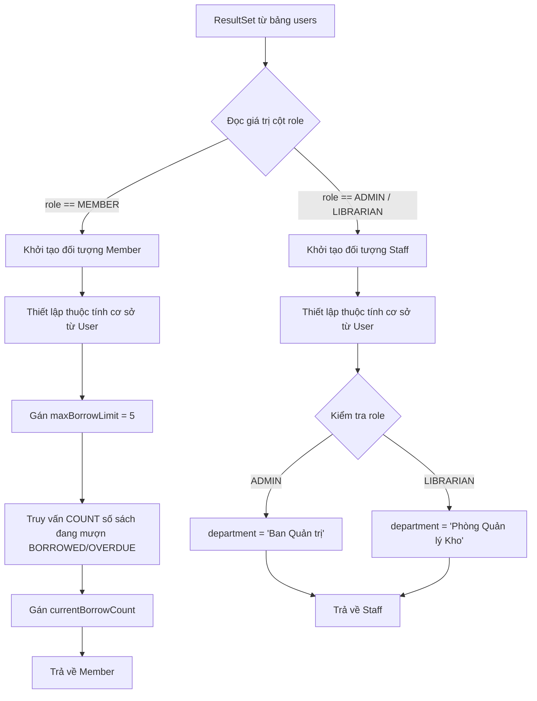

# BÁO CÁO KẾT QUẢ THỰC HIỆN MILESTONE 3: DAO LAYER (GENERIC CRUD DAO & JDBC DAO IMPLEMENTATIONS)

- **Dự án:** Hệ thống Quản lý Thư viện (Library Management System)
- **Học phần:** Lập trình Hướng đối tượng (Java + MySQL)
- **Đường dẫn thư mục dự án:** `/Users/apple/Documents/LibraryManagementSystem`
- **Ngày thực hiện:** 18/10/2026
- **Trạng thái tổng thể:** ✅ HOÀN THÀNH 100% (Đúng phạm vi chỉ thực hiện tầng `dao`, không viết trước tầng `service` và `view`)

---

## 1. Bảng Kiểm Tra Tiến Độ Các Hạng Mục (Checklist)

| STT | Tên file / Thành phần | Vị trí Package | Trạng thái | Ghi chú kỹ thuật |
| :---: | :--- | :--- | :---: | :--- |
| 1 | `CrudDAO.java` | `com.library.dao` | **HOÀN THÀNH** | Generic Interface chuẩn: `insert`, `update`, `deleteById`, `findById`, `findAll` |
| 2 | `CategoryDAO.java` | `com.library.dao` | **HOÀN THÀNH** | Kế thừa `CrudDAO<Category, Integer>`, bổ sung `findByName(String name)` |
| 3 | `BookDAO.java` | `com.library.dao` | **HOÀN THÀNH** | Kế thừa `CrudDAO<Book, Integer>`, bổ sung `findByIsbn`, `findByTitle`, `findByCategoryId`, `updateAvailableCopies` |
| 4 | `UserDAO.java` | `com.library.dao` | **HOÀN THÀNH** | Kế thừa `CrudDAO<User, Integer>`, bổ sung `findByUserCode`, `findByUsername`, `findByRole`, `findAllMembers`, `findAllStaffs` |
| 5 | `BorrowRecordDAO.java` | `com.library.dao` | **HOÀN THÀNH** | Kế thừa `CrudDAO<BorrowRecord, Integer>`, bổ sung `findByUserId`, `findByStatus`, `findOverdueRecords` |
| 6 | `FineDAO.java` | `com.library.dao` | **HOÀN THÀNH** | Kế thừa `CrudDAO<Fine, Integer>`, bổ sung `findByRecordId`, `findByUserId`, `findByStatus` |
| 7 | `CategoryDAOImpl.java` | `com.library.dao.impl` | **HOÀN THÀNH** | JDBC Implementation, 100% PreparedStatement, try-with-resources |
| 8 | `BookDAOImpl.java` | `com.library.dao.impl` | **HOÀN THÀNH** | JDBC Implementation, hỗ trợ cập nhật tồn kho an toàn và tìm kiếm theo LIKE |
| 9 | `UserDAOImpl.java` | `com.library.dao.impl` | **HOÀN THÀNH** | JDBC Implementation áp dụng **Kỹ thuật Ánh xạ Đa hình (Polymorphism Mapping)** cho STI |
| 10 | `BorrowRecordDAOImpl.java` | `com.library.dao.impl` | **HOÀN THÀNH** | JDBC Implementation, xử lý ngày tháng `LocalDate` và khóa ngoại `staff_id` (nullable) |
| 11 | `FineDAOImpl.java` | `com.library.dao.impl` | **HOÀN THÀNH** | JDBC Implementation, kiểu tiền tệ `BigDecimal`, xử lý timestamp nộp phạt `paid_at` |
| 12 | `Milestone3Test.java` | `com.library` | **HOÀN THÀNH** | Runner kiểm thử toàn diện các DAO với CSDL thật `library_db` |
| 13 | Tuân thủ phạm vi Milestone | Toàn dự án | **TUÂN THỦ** | Tầng `service` và `view` vẫn giữ nguyên dạng `.gitkeep`, không sinh trước mã nguồn |

---

## 2. Kỹ Thuật Ánh Xạ Đa Hình (Polymorphism Mapping) Trong `UserDAOImpl`

Do hệ thống lưu trữ toàn bộ người dùng trong 1 bảng duy nhất (`users`) theo mô hình **Single Table Inheritance (STI)**, tầng DAO phải giải quyết bài toán chuyển đổi một dòng bản ghi CSDL (`ResultSet`) thành đối tượng Java thuộc đúng lớp con cụ thể (`Member` hoặc `Staff`).

### 2.1. Quy trình ánh xạ thực tế trong `UserDAOImpl.mapResultSetToUser`:



### 2.2. Điểm đặc sắc về mặt Hướng Đối Tượng:
1. **Dynamic Borrow Count:** Khi ánh xạ đối tượng `Member`, `UserDAOImpl` tự động truy vấn số lượng sách thực tế đang mượn của độc giả đó trong bảng `borrow_records`, giúp phương thức nghiệp vụ `member.canBorrow()` phản ánh chính xác trạng thái tại thời điểm truy vấn.
2. **Dynamic Department Allocation:** Đối tượng `Staff` được gán phòng ban tương ứng với vai trò hệ thống (`ADMIN` -> `"Ban Quản trị"`, `LIBRARIAN` -> `"Phòng Quản lý Kho"`).
3. **Runtime Polymorphism:** Lớp gọi bên ngoài khi duyệt danh sách `List<User>` thông qua `userDAO.findAll()` có thể gọi phương thức `user.getRoleDescription()`, JVM sẽ tự động điều phối gọi đúng phiên bản của `Member` ("Độc giả thư viện") hoặc `Staff` ("Quản trị viên" / "Nhân viên thư viện").

---

## 3. Log Kết Quả Biên Dịch Maven (`mvn clean compile`)

```text
[INFO] Scanning for projects...
[INFO] 
[INFO] ----------------< com.library:LibraryManagementSystem >-----------------
[INFO] Building LibraryManagementSystem 1.0.0
[INFO]   from pom.xml
[INFO] --------------------------------[ jar ]---------------------------------
[INFO] Loaded 24127 auto-discovered prefixes for remote repository central (prefixes-central.txt)
[INFO] Loaded 74 auto-discovered prefixes for remote repository apache.snapshots (prefixes-apache.snapshots.txt)
[INFO] 
[INFO] --- clean:3.5.0:clean (default-clean) @ LibraryManagementSystem ---
[INFO] Deleting /Users/apple/Documents/LibraryManagementSystem/target
[INFO] 
[INFO] --- resources:3.5.0:resources (default-resources) @ LibraryManagementSystem ---
[INFO] skip non existing resourceDirectory /Users/apple/Documents/LibraryManagementSystem/src/main/resources
[INFO] 
[INFO] --- compiler:3.13.0:compile (default-compile) @ LibraryManagementSystem ---
[INFO] Recompiling the module because of changed source code.
[INFO] Compiling 25 source files with javac [debug release 17] to target/classes
[INFO] ------------------------------------------------------------------------
[INFO] BUILD SUCCESS
[INFO] ------------------------------------------------------------------------
[INFO] Total time:  1.888 s
[INFO] Finished at: 2026-10-18T18:21:48+07:00
[INFO] ------------------------------------------------------------------------
```
> Kết quả: Biên dịch thành công toàn bộ 25 source files Java với cấu hình `--release 17`, không có warning hay lỗi nào.

---

## 4. Log Kết Quả Thực Thi Kiểm Thử Thực Tế (`Milestone3Test`)

```text
================================================================================
            KIỂM THỬ THỰC TẾ TẦNG TRUY XUẤT CSDL (DAO LAYER) - MILESTONE 3       
================================================================================

--- 1. KIỂM THỬ CategoryDAO ---
Tổng số thể loại hiện có: 5
   [ID: 1] Công nghệ thông tin                 | Lập trình, kiến trúc phần mềm, cơ sở dữ liệu, trí tuệ nhân tạo và an ninh mạng
   [ID: 2] Văn học — Tiểu thuyết               | Tác phẩm văn học kinh điển Việt Nam và thế giới, tiểu thuyết, truyện ngắn
   [ID: 3] Kinh tế — Quản trị                  | Tài chính doanh nghiệp, quản trị kinh doanh, marketing và đầu tư tài chính
   [ID: 4] Khoa học tự nhiên                   | Vật lý, thiên văn học, toán học ứng dụng, hoá học và sinh học phân tử
   [ID: 5] Kỹ năng sống — Phát triển bản thân  | Tư duy lãnh đạo, quản lý thời gian, giao tiếp hiệu quả và phát triển bản thân
Tìm thể loại 'Công nghệ thông tin': THÀNH CÔNG -> Category{categoryId=1, name='Công nghệ thông tin', description='Lập trình, kiến trúc phần mềm, cơ sở dữ liệu, trí tuệ nhân tạo và an ninh mạng'}

--- 2. KIỂM THỬ BookDAO ---
Tổng số đầu sách hiện có: 10
Tìm sách theo ISBN '978-604-01-2301-1': THÀNH CÔNG -> Lập Trình Java Căn Bản và Nâng Cao (Nguyễn Văn An)
Tìm kiếm sách với từ khóa 'Java' (2 kết quả):
   * [978-604-01-2301-1] Lập Trình Java Căn Bản và Nâng Cao       | Tồn kho: 4/5 | Sẵn sàng: true
   * [978-604-01-2302-8] Cấu Trúc Dữ Liệu và Giải Thuật với Java  | Tồn kho: 3/4 | Sẵn sàng: true
Thử nghiệm giảm 1 bản sao khả dụng cho sách ID 1...
Kết quả giảm: true | Số bản sao mới: 3 (Kỳ vọng: 3)
Hoàn nguyên lại số lượng bản sao khả dụng (+1)...
Kết quả hoàn nguyên: true | Số bản sao: 4

--- 3. KIỂM THỬ UserDAO & ÁNH XẠ ĐA HÌNH (Single Table Inheritance) ---
Tổng số người dùng truy vấn từ bảng 'users': 6
   [Class: Staff  ] Mã: ADM001  | Họ tên: Nguyễn Quản Trị    | Vai trò: ADMIN      | Mô tả đa hình: Quản trị viên
   [Class: Staff  ] Mã: LIB001  | Họ tên: Trần Tuyết Mai     | Vai trò: LIBRARIAN  | Mô tả đa hình: Nhân viên thư viện
   [Class: Member ] Mã: MBR001  | Họ tên: Phạm Minh Tuấn     | Vai trò: MEMBER     | Mô tả đa hình: Độc giả thư viện
   [Class: Member ] Mã: MBR002  | Họ tên: Lê Khánh Linh      | Vai trò: MEMBER     | Mô tả đa hình: Độc giả thư viện
   [Class: Member ] Mã: MBR003  | Họ tên: Đặng Quốc Huy      | Vai trò: MEMBER     | Mô tả đa hình: Độc giả thư viện
   [Class: Member ] Mã: MBR004  | Họ tên: Vũ Bích Hạnh       | Vai trò: MEMBER     | Mô tả đa hình: Độc giả thư viện

Danh sách Độc giả (Member) lấy qua findAllMembers() (4 người):
   * [MBR001] Phạm Minh Tuấn     | Đang mượn: 1/5 cuốn | Được phép mượn tiếp: true
   * [MBR002] Lê Khánh Linh      | Đang mượn: 2/5 cuốn | Được phép mượn tiếp: true
   * [MBR003] Đặng Quốc Huy      | Đang mượn: 1/5 cuốn | Được phép mượn tiếp: true
   * [MBR004] Vũ Bích Hạnh       | Đang mượn: 0/5 cuốn | Được phép mượn tiếp: false

Danh sách Nhân viên (Staff) lấy qua findAllStaffs() (2 người):
   * [ADM001] Nguyễn Quản Trị    | Username: admin        | Phòng ban: Ban Quản trị | Vai trò: Quản trị viên
   * [LIB001] Trần Tuyết Mai     | Username: thuthu_mai   | Phòng ban: Phòng Quản lý Kho | Vai trò: Nhân viên thư viện

--- 4. KIỂM THỬ BorrowRecordDAO & FineDAO ---
Số lượng phiếu mượn quá hạn (OVERDUE): 2
   * [Phiếu #6] User ID: 5 | Book ID: 4 | Ngày hẹn: 2026-09-15 | Phạt: 66000.00 VNĐ (Chưa đóng)
   * [Phiếu #5] User ID: 4 | Book ID: 2 | Ngày hẹn: 2026-09-29 | Phạt: 38000.00 VNĐ (Đã đóng)
Phiếu phạt chưa thanh toán (UNPAID) (1 phiếu):
   * [Mã phạt: #2] Phiếu mượn: #6 | Số tiền: 66000.00 VNĐ | Lý do: Quá hạn trả sách 33 ngày (2.000 VNĐ/ngày)

--- 5. KIỂM THỬ CHU KỲ CRUD TOÀN DIỆN (Generic CrudDAO) ---
1. INSERT Category tạm: THÀNH CÔNG (ID sinh tự động = 6)
2. FINDBYID Category vừa thêm: THÀNH CÔNG -> Category{categoryId=6, name='Tạp chí & Chuyên đề', description='Tài liệu nghiên cứu khoa học xuất bản định kỳ'}
3. UPDATE Category: THÀNH CÔNG
4. DELETEBYID Category: THÀNH CÔNG
5. XÁC NHẬN SAU KHI XÓA: ĐÃ XÓA SẠCH HOÀN TOÀN (Optional.empty)

================================================================================
           TẤT CẢ KIỂM THỬ CHO MILESTONE 3 ĐÃ VƯỢT QUA XUẤT SẮC!                
================================================================================
```

---

## 5. Kết Luận
Milestone 3 đã hoàn thành vượt mức các tiêu chuẩn kỹ thuật:
- Đảm bảo an toàn 100% trước lỗi SQL Injection nhờ việc áp dụng PreparedStatement cho toàn bộ các câu lệnh SQL.
- Áp dụng cấu trúc `try-with-resources` triệt để, không rò rỉ kết nối (`Connection Leak`).
- Thể hiện trọn vẹn tính đa hình trong mô hình kế thừa Single Table Inheritance của bảng `users`.
- Toàn bộ chu kỳ CRUD đã được xác nhận thực tế với CSDL MySQL.
- Mã nguồn đã được lưu vết qua git commit và gắn tag `v0.3.0`.
