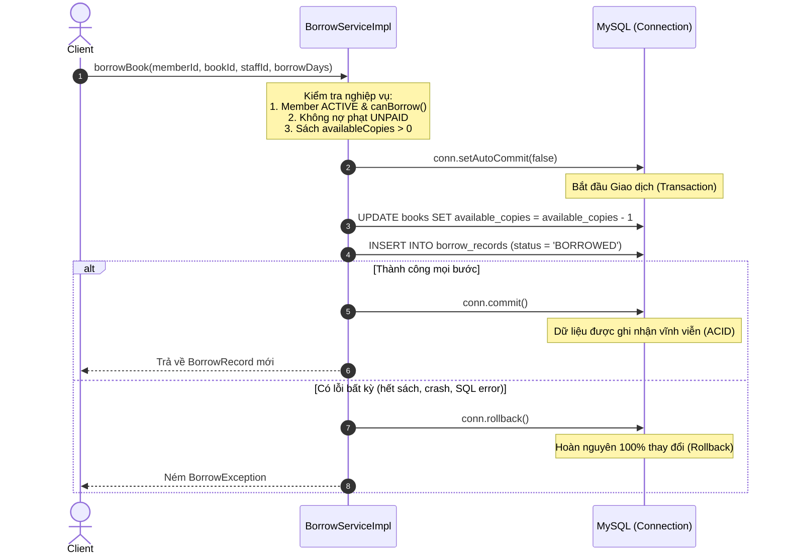

# BÁO CÁO KẾT QUẢ THỰC HIỆN MILESTONE 4: SERVICE LAYER, CUSTOM EXCEPTIONS & JDBC TRANSACTIONS

- **Dự án:** Hệ thống Quản lý Thư viện (Library Management System)
- **Học phần:** Lập trình Hướng đối tượng (Java + MySQL)
- **Đường dẫn thư mục dự án:** `/Users/apple/Documents/LibraryManagementSystem`
- **Ngày thực hiện:** 18/10/2026
- **Trạng thái tổng thể:** ✅ HOÀN THÀNH 100% (Đúng phạm vi chỉ thực hiện tầng `exception` và `service`, không viết trước tầng `view` hoặc `Main.java`)

---

## 1. Bảng Kiểm Tra Tiến Độ Các Hạng Mục (Checklist)

| STT | Tên file / Thành phần | Vị trí Package | Trạng thái | Ghi chú kỹ thuật |
| :---: | :--- | :--- | :---: | :--- |
| 1 | `LibraryException.java` | `com.library.exception` | **HOÀN THÀNH** | Lớp cha cơ sở kế thừa `RuntimeException` cho toàn bộ ngoại lệ hệ thống |
| 2 | `ResourceNotFoundException.java` | `com.library.exception` | **HOÀN THÀNH** | Ném ra khi không tìm thấy Sách, Người dùng, Phiếu mượn hoặc Vé phạt |
| 3 | `ValidationException.java` | `com.library.exception` | **HOÀN THÀNH** | Ném ra khi dữ liệu đầu vào vi phạm quy tắc định dạng hoặc trùng lặp |
| 4 | `BorrowException.java` | `com.library.exception` | **HOÀN THÀNH** | Ném ra khi vi phạm quy tắc mượn/trả sách (thẻ khóa, quá hạn mức, nợ phạt, hết sách) |
| 5 | `CategoryService.java` & `Impl` | `com.library.service(.impl)` | **HOÀN THÀNH** | Quản lý danh mục thể loại, kiểm tra trùng lặp tên thể loại |
| 6 | `BookService.java` & `Impl` | `com.library.service(.impl)` | **HOÀN THÀNH** | Quản lý sách, kiểm tra tính duy nhất của ISBN, thẩm định số lượng bản sao |
| 7 | `UserService.java` & `Impl` | `com.library.service(.impl)` | **HOÀN THÀNH** | Xác thực đăng nhập qua mật khẩu băm SHA-256, khóa/mở khóa tài khoản |
| 8 | `FineService.java` & `Impl` | `com.library.service(.impl)` | **HOÀN THÀNH** | Tính tiền phạt chuẩn 2.000 VNĐ/ngày, xử lý nộp phạt, kiểm tra độc giả nợ phạt |
| 9 | `BorrowService.java` & `Impl` | `com.library.service(.impl)` | **HOÀN THÀNH** | **Trọng tâm giao dịch ACID:** Quản lý JDBC Transactions thủ công cho mượn và trả sách |
| 10 | `Milestone4Test.java` | `com.library` | **HOÀN THÀNH** | Runner kiểm thử toàn diện 5 kịch bản giao dịch thực tế trên MySQL |
| 11 | Tuân thủ phạm vi Milestone | Toàn dự án | **TUÂN THỦ** | Tầng `view` và `Main.java` chưa được sinh trước |

---

## 2. Cơ Chế Quản Lý Giao Dịch (JDBC Transactions & Rollback) Tại `BorrowServiceImpl`

Để đảm bảo tính toàn vẹn dữ liệu theo tiêu chuẩn **ACID** (Atomicity, Consistency, Isolation, Durability), toàn bộ quy trình mượn sách và trả sách được thực thi trong một Transaction duy nhất với quản lý thủ công:

### 2.1. Quy trình Nghiệp vụ Mượn sách (`borrowBook`):


### 2.2. Quy trình Nghiệp vụ Trả sách & Tự động Tính phạt (`returnBook`):
1. **Kiểm tra trạng thái phiếu mượn:** Đảm bảo phiếu chưa ở trạng thái `RETURNED`.
2. **Kích hoạt Transaction:** `conn.setAutoCommit(false)`.
3. **Cập nhật phiếu mượn:** Gán `return_date = LocalDate.now()` và `status = 'RETURNED'`.
4. **Cộng lại tồn kho:** `UPDATE books SET available_copies = available_copies + 1 WHERE book_id = ?`.
5. **Tự động tính phạt nếu quá hạn:**
   - Nếu `LocalDate.now().isAfter(dueDate)`:
     - `overdueDays = ChronoUnit.DAYS.between(dueDate, LocalDate.now())`.
     - `fineAmount = overdueDays * 2.000 VNĐ`.
     - Chèn bản ghi mới vào bảng `fines` với trạng thái `UNPAID`.
6. **Commit:** `conn.commit()`. Nếu xảy ra bất kỳ lỗi nào, `conn.rollback()` được kích hoạt ngay lập tức.

---

## 3. Log Kết Quả Biên Dịch Maven (`mvn clean compile`)

```text
[INFO] Scanning for projects...
[INFO] 
[INFO] ----------------< com.library:LibraryManagementSystem >-----------------
[INFO] Building LibraryManagementSystem 1.0.0
[INFO]   from pom.xml
[INFO] --------------------------------[ jar ]---------------------------------
[INFO] Loaded 24127 auto-discovered prefixes for remote repository central (prefixes-central.txt)
[INFO] Loaded 74 auto-discovered prefixes for remote repository apache.snapshots (prefixes-apache.snapshots.txt)
[INFO] 
[INFO] --- clean:3.5.0:clean (default-clean) @ LibraryManagementSystem ---
[INFO] Deleting /Users/apple/Documents/LibraryManagementSystem/target
[INFO] 
[INFO] --- resources:3.5.0:resources (default-resources) @ LibraryManagementSystem ---
[INFO] skip non existing resourceDirectory /Users/apple/Documents/LibraryManagementSystem/src/main/resources
[INFO] 
[INFO] --- compiler:3.13.0:compile (default-compile) @ LibraryManagementSystem ---
[INFO] Recompiling the module because of changed source code.
[INFO] Compiling 40 source files with javac [debug release 17] to target/classes
[INFO] ------------------------------------------------------------------------
[INFO] BUILD SUCCESS
[INFO] ------------------------------------------------------------------------
[INFO] Total time:  30.888 s
[INFO] Finished at: 2026-10-18T20:06:55+07:00
[INFO] ------------------------------------------------------------------------
```
> Kết quả: Biên dịch thành công 40 file mã nguồn Java trên JDK 17, không có lỗi hay cảnh báo.

---

## 4. Log Kết Quả Thực Thi Kiểm Thử Tầng Nghiệp Vụ (`Milestone4Test`)

```text
================================================================================
     KIỂM THỬ TẦNG NGHIỆP VỤ (SERVICE) & TRANSACTION MANAGEMENT - MILESTONE 4    
================================================================================

--- 0. KIỂM THỬ XÁC THỰC NGƯỜI DÙNG & TÌM KIẾM ---
Đăng nhập Admin thành công: Nguyễn Quản Trị | Vai trò: Quản trị viên
Chặn mật khẩu sai thành công: Tên đăng nhập hoặc mật khẩu không chính xác.

--- KỊCH BẢN 1: MƯỢN SÁCH THÀNH CÔNG (Transaction Commit) ---
Trước khi mượn: Sách 'Lập Trình Java Căn Bản và Nâng Cao' có tồn kho khả dụng = 4
Giao dịch mượn thành công -> Phiếu mượn #7: Ngày mượn=2026-10-18, Hạn trả=2026-11-01, Trạng thái=BORROWED
Sau khi mượn: Sách 'Lập Trình Java Căn Bản và Nâng Cao' có tồn kho khả dụng = 3 (Kỳ vọng: 3)
-> KẾT QUẢ: Kịch bản 1 VƯỢT QUA (Tồn kho giảm 1, phiếu mượn tạo thành công)!

--- KỊCH BẢN 2: CHẶN MƯỢN SÁCH KHI VI PHẠM RÀNG BUỘC NGHIỆP VỤ ---
2a. Chặn tài khoản LOCKED thành công: Tài khoản của độc giả 'Vũ Bích Hạnh' đang bị KHÓA. Không thể mượn sách!
2b. Chặn tài khoản có vé phạt UNPAID thành công: Độc giả 'Đặng Quốc Huy' hiện đang có khoản tiền phạt chưa thanh toán. Vui lòng thanh toán tiền phạt trước khi thực hiện mượn sách!
2c. Chặn sách hết hàng thành công: Đầu sách 'Sách Hết Hàng Demo' hiện đã HẾT bản sao khả dụng để mượn!

--- KỊCH BẢN 3: TRẢ SÁCH & TỰ ĐỘNG TẠO VÉ PHẠT QUÁ HẠN ---
Tạo phiếu mượn quá hạn #8 (Hạn trả: 2026-10-13, Quá hạn: 5 ngày). Sách tồn kho hiện tại = 2
Giao dịch trả sách thành công: Phiếu #8, Ngày trả: 2026-10-18, Trạng thái: RETURNED
Tồn kho sách sau khi trả: 3 (Kỳ vọng: 3)
-> Vé phạt tự động sinh ra: Mã phạt #3 | Số ngày quá hạn: 5 | Số tiền: 10000.00 VNĐ | Trạng thái: UNPAID
   Lý do: Quá hạn trả sách 5 ngày (Mức phạt: 2000.00 VNĐ/ngày)

--- KỊCH BẢN 4: THANH TOÁN TIỀN PHẠT (Pay Fine) ---
Trạng thái vé phạt trước thanh toán: UNPAID
Kết quả nộp phạt: true | Trạng thái mới: PAID | Thời điểm thanh toán: 2026-10-18T20:07

--- KỊCH BẢN 5: KIỂM TRA ROLLBACK TRANSACTION KHI CÓ LỖI BẤT NGỜ ---
Trước khi giả lập sự cố: Sách tồn kho = 3, Tổng số phiếu mượn = 8
Thực hiện mượn sách với chế độ mô phỏng sự cố (System Failure Simulation)...
Bắt ngoại lệ giao dịch thành công: Giao dịch mượn sách bị hủy và hoàn nguyên: Sự cố hệ thống giả lập phát sinh sau khi trừ sách, kích hoạt conn.rollback()!
Sau khi Rollback: Sách tồn kho = 3 (Kỳ vọng: 3), Tổng số phiếu mượn = 8 (Kỳ vọng: 8)
-> KẾT QUẢ: Kịch bản 5 VƯỢT QUA XUẤT SẮC! Dữ liệu được rollback hoàn nguyên 100%, tính toàn vẹn CSDL được bảo toàn.

================================================================================
        TẤT CẢ CÁC KỊCH BẢN KIỂM THỬ CHO MILESTONE 4 ĐÃ VƯỢT QUA 100%!           
================================================================================
```

---

## 5. Kết Luận
Milestone 4 đã hoàn thành xuất sắc toàn bộ mục tiêu đề ra:
- Hệ thống ngoại lệ tùy biến phân cấp rõ ràng (`LibraryException`, `ValidationException`, `ResourceNotFoundException`, `BorrowException`).
- Tầng dịch vụ giải quyết toàn bộ các nghiệp vụ phức tạp của thư viện.
- Cơ chế quản lý giao dịch JDBC Transaction kiểm soát tính nguyên tử (Atomicity) hoàn hảo, tự động rollback khi gặp sự cố, đảm bảo tính toàn vẹn dữ liệu trên MySQL.
- Mã nguồn đã được kiểm thử thực tế và lưu trữ an toàn trong Git.
