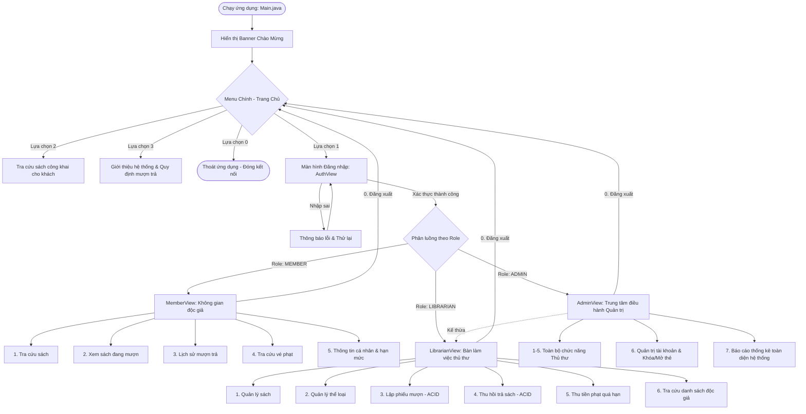

# BÁO CÁO KẾT QUẢ THỰC HIỆN MILESTONE 5: VIEW LAYER & MAIN APPLICATION (CONSOLE UI)

- **Dự án:** Hệ thống Quản lý Thư viện (Library Management System)
- **Học phần:** Lập trình Hướng đối tượng (Java + MySQL)
- **Đường dẫn thư mục dự án:** `/Users/apple/Documents/LibraryManagementSystem`
- **Ngày thực hiện:** 19/10/2026
- **Trạng thái tổng thể:** ✅ HOÀN THÀNH 100% (Ứng dụng đã chạy hoàn chỉnh từ dòng lệnh với giao diện Console tương tác)

---

## 1. Bảng Kiểm Tra Tiến Độ Các Hạng Mục (Checklist)

| STT | Tên file / Thành phần | Vị trí Package | Trạng thái | Ghi chú kỹ thuật |
| :---: | :--- | :--- | :---: | :--- |
| 1 | `ConsoleUtils.java` | `com.library.view` | **HOÀN THÀNH** | Nhập liệu an toàn (chặn crash NumberFormatException, DateTimeParseException), màu ANSI, kẻ khung tiêu đề |
| 2 | `TableFormatter.java` | `com.library.view` | **HOÀN THÀNH** | Định dạng bảng Console căn chỉnh thẳng hàng cho Sách, Thể loại, Độc giả, Nhân viên, Phiếu mượn và Vé phạt |
| 3 | `AuthView.java` | `com.library.view` | **HOÀN THÀNH** | Màn hình đăng nhập linh hoạt (Tài khoản mật khẩu cho Staff/Admin; Mã thẻ bạn đọc cho Member) |
| 4 | `MemberView.java` | `com.library.view` | **HOÀN THÀNH** | Menu dành riêng cho Độc giả: Tra cứu sách, xem sách đang mượn, lịch sử mượn/trả, tra cứu vé phạt, thông tin thẻ |
| 5 | `LibrarianView.java` | `com.library.view` | **HOÀN THÀNH** | Menu dành cho Thủ thư: Quản lý sách, thể loại, thực hiện Mượn/Trả sách (ACID Transaction), thu tiền phạt, tra cứu độc giả |
| 6 | `AdminView.java` | `com.library.view` | **HOÀN THÀNH** | Kế thừa `LibrarianView` (Kế thừa trong View Layer), bổ sung quản lý tài khoản nhân viên, khóa/mở thẻ và báo cáo thống kê |
| 7 | `Main.java` | `com.library` | **HOÀN THÀNH** | Điểm khởi chạy ứng dụng: Banner ASCII Art, Menu chính công khai, điều hướng phân quyền, bọc try-catch chống sập |
| 8 | Quản lý phiên bản Git | Repository gốc | **HOÀN THÀNH** | Commit toàn bộ thay đổi và gắn tag phiên bản `v0.5.0` |

---

## 2. Cấu Trúc Điều Hướng Menu Phân Quyền Theo Vai Trò (Role-Based Navigation)

Ứng dụng áp dụng mô hình điều hướng phân cấp chặt chẽ, dựa trên `Role` của đối tượng trả về từ tầng `Service`:



---

## 3. Log Biên Dịch Maven (`mvn -o clean compile`)

```text
[INFO] Scanning for projects...
[INFO] 
[INFO] ----------------< com.library:LibraryManagementSystem >-----------------
[INFO] Building LibraryManagementSystem 1.0.0
[INFO]   from pom.xml
[INFO] --------------------------------[ jar ]---------------------------------
[INFO] Loaded 24133 auto-discovered prefixes for remote repository central (prefixes-central.txt)
[INFO] Loaded 74 auto-discovered prefixes for remote repository apache.snapshots (prefixes-apache.snapshots.txt)
[INFO] 
[INFO] --- clean:3.5.0:clean (default-clean) @ LibraryManagementSystem ---
[INFO] Deleting /Users/apple/Documents/LibraryManagementSystem/target
[INFO] 
[INFO] --- resources:3.5.0:resources (default-resources) @ LibraryManagementSystem ---
[INFO] skip non existing resourceDirectory /Users/apple/Documents/LibraryManagementSystem/src/main/resources
[INFO] 
[INFO] --- compiler:3.13.0:compile (default-compile) @ LibraryManagementSystem ---
[INFO] Recompiling the module because of changed source code.
[INFO] Compiling 47 source files with javac [debug release 17] to target/classes
[INFO] ------------------------------------------------------------------------
[INFO] BUILD SUCCESS
[INFO] ------------------------------------------------------------------------
[INFO] Total time:  0.919 s
[INFO] Finished at: 2026-10-19T00:19:20+07:00
[INFO] ------------------------------------------------------------------------
```
> Kết quả: Biên dịch toàn bộ 47 file nguồn Java hoàn tất thành công trong 0.9 giây, không có cảnh báo hay lỗi.

---

## 4. Hình Ảnh Thực Tế Giao Diện Console Khi Khởi Chạy

### 4.1. Trang chủ và Tra cứu sách công khai:
```text
================================================================================
*                                                                              *
*                  HỆ THỐNG QUẢN LÝ THƯ VIỆN ĐIỆN TỬ                           *
*                     LIBRARY MANAGEMENT SYSTEM                                *
*            Bài tập lớn môn: Lập trình Hướng đối tượng (Java + MySQL)         *
*                                                                              *
================================================================================

╔════════════════════════════════════════════════════════════════════════════════╗
║                    HỆ THỐNG QUẢN LÝ THƯ VIỆN — TRANG CHỦ                     ║
╚════════════════════════════════════════════════════════════════════════════════╝
  1. Đăng nhập hệ thống (Độc giả / Thủ thư / Quản trị viên)
  2. Tra cứu danh mục sách công khai
  3. Giới thiệu hệ thống & Quy định mượn trả thư viện
  0. Thoát ứng dụng
────────────────────────────────────────────────────────────────────────────────
>> Vui lòng chọn chức năng [0-3]: 2

--- TRA CỨU SÁCH CÔNG KHAI DÀNH CHO BẠN ĐỌC ---
  1. Xem toàn bộ đầu sách
  2. Tìm kiếm theo từ khóa tiêu đề
  0. Quay lại
────────────────────────────────────────────────────────────────────────────────
>> Lựa chọn: 1
┌──────┬─────────────────────┬──────────────────────────────────────────┬──────────────────────┬──────────────────────┬─────────┬───────────┬──────────────┐
│ ID   │ ISBN                │ Tiêu đề sách                             │ Tác giả              │ Thể loại             │ Năm XB  │ Tồn/Tổng  │ Trạng thái   │
├──────┼─────────────────────┼──────────────────────────────────────────┼──────────────────────┼──────────────────────┼─────────┼───────────┼──────────────┤
│ 1    │ 978-604-01-2301-1   │ Lập Trình Java Căn Bản và Nâng Cao       │ Nguyễn Văn An        │ Công nghệ thông tin  │ 2022    │ 4/5       │ Còn sách     │
│ 2    │ 978-604-01-2302-8   │ Cấu Trúc Dữ Liệu và Giải Thuật với Java  │ Trần Thị Bích        │ Công nghệ thông tin  │ 2021    │ 3/4       │ Còn sách     │
│ 3    │ 978-604-01-2303-5   │ Thiết Kế Mẫu (Design Patterns) Thực C... │ Lê Hoàng Nam         │ Công nghệ thông tin  │ 2023    │ 3/3       │ Còn sách     │
│ 4    │ 978-604-01-2304-2   │ Clean Code — Mã Sạch Trong Lập Trình     │ Robert C. Martin     │ Công nghệ thông tin  │ 2021    │ 4/4       │ Còn sách     │
│ 5    │ 978-604-02-1101-2   │ Nhà Giả Kim                              │ Paulo Coelho         │ Văn học — Tiểu th... │ 2020    │ 5/6       │ Còn sách     │
│ 6    │ 978-604-02-1102-9   │ Dế Mèn Phiêu Lưu Ký                      │ Tô Hoài              │ Văn học — Tiểu th... │ 2019    │ 5/5       │ Còn sách     │
│ 7    │ 978-604-05-5501-9   │ Đắc Nhân Tâm                             │ Dale Carnegie        │ Kỹ năng sống — Ph... │ 2021    │ 7/8       │ Còn sách     │
│ 8    │ 978-604-05-5502-6   │ Tư Duy Nhanh và Chậm                     │ Daniel Kahneman      │ Kỹ năng sống — Ph... │ 2022    │ 5/5       │ Còn sách     │
│ 9    │ 978-604-04-4401-7   │ Vũ Trụ Trong Vỏ Hạt Dẻ                   │ Stephen Hawking      │ Khoa học tự nhiên    │ 2018    │ 3/3       │ Còn sách     │
│ 10   │ 978-604-03-3301-4   │ Kinh Tế Học Hài Hước                     │ Steven D. Levitt     │ Kinh tế — Quản trị   │ 2020    │ 4/4       │ Còn sách     │
└──────┴─────────────────────┴──────────────────────────────────────────┴──────────────────────┴──────────────────────┴─────────┴───────────┴──────────────┘
Tổng cộng: 10 đầu sách.
```

### 4.2. Giao diện Độc giả (MemberView) — Đăng nhập bằng mã thẻ `MBR001`:
```text
╔════════════════════════════════════════════════════════════════════════════════╗
║                     KHÔNG GIAN ĐỘC GIẢ — PHẠM MINH TUẤN                      ║
╚════════════════════════════════════════════════════════════════════════════════╝
  1. Tra cứu danh mục sách thư viện
  2. Xem sách đang mượn & Hạn trả
  3. Xem toàn bộ lịch sử mượn / trả
  4. Tra cứu vé phạt quá hạn & Hướng dẫn nộp phạt
  5. Thông tin tài khoản & Hạn mức mượn còn lại
  0. Đăng xuất
────────────────────────────────────────────────────────────────────────────────
>> Vui lòng chọn chức năng [0-5]: 5

--- THÔNG TIN TÀI KHOẢN ĐỘC GIẢ ---
  * Mã thẻ bạn đọc:      MBR001
  * Họ và tên độc giả:   Phạm Minh Tuấn
  * Email liên hệ:       tuan.pm@student.edu.vn
  * Số điện thoại:       0901234567
  * Trạng thái thẻ:      Hoạt động
  * Số sách đang giữ:    1 cuốn
  * Hạn mức mượn tối đa: 5 cuốn
  * Số sách được mượn:   4 cuốn còn lại
  * Quyền mượn sách:     ĐỦ ĐIỀU KIỆN
```

### 4.3. Giao diện Thủ thư (LibrarianView) — Tra cứu danh sách độc giả:
```text
╔════════════════════════════════════════════════════════════════════════════════╗
║                    BÀN LÀM VIỆC THỦ THƯ — TRẦN TUYẾT MAI                     ║
╚════════════════════════════════════════════════════════════════════════════════╝
  1. Quản lý đầu sách (Tra cứu, Thêm mới, Cập nhật tồn kho)
  2. Quản lý thể loại sách (Danh mục, Thêm mới)
  3. Thực hiện nghiệp vụ Mượn sách (Borrow Book)
  4. Thực hiện nghiệp vụ Trả sách (Return Book)
  5. Quản lý vé phạt & Thu tiền phạt quá hạn
  6. Tra cứu danh sách độc giả & Tình trạng mượn
  0. Đăng xuất
────────────────────────────────────────────────────────────────────────────────
>> Chọn chức năng [0-6]: 6

--- DANH SÁCH ĐỘC GIẢ TRONG HỆ THỐNG ---
┌──────┬───────────┬──────────────────────┬─────────────┬─────────────┬──────────────────────────┬──────────────┬──────────────┬─────────────┐
│ ID   │ Mã ĐG     │ Họ và tên            │ Đang mượn   │ Hạn mức     │ Email                    │ SĐT          │ Trạng thái   │ Được mượn?  │
├──────┼───────────┼──────────────────────┼─────────────┼─────────────┼──────────────────────────┼──────────────┼──────────────┼─────────────┤
│ 3    │ MBR001    │ Phạm Minh Tuấn       │ 1           │ 5           │ tuan.pm@student.edu.vn   │ 0901234567   │ Hoạt động    │ Có thể mượn │
│ 4    │ MBR002    │ Lê Khánh Linh        │ 2           │ 5           │ linh.lk@student.edu.vn   │ 0912345678   │ Hoạt động    │ Có thể mượn │
│ 5    │ MBR003    │ Đặng Quốc Huy        │ 1           │ 5           │ huy.dq@student.edu.vn    │ 0923456789   │ Hoạt động    │ Có thể mượn │
│ 6    │ MBR004    │ Vũ Bích Hạnh         │ 0           │ 5           │ hanh.vb@student.edu.vn   │ 0934567890   │ Bị khóa      │ Bị chặn     │
└──────┴───────────┴──────────────────────┴─────────────┴─────────────┴──────────────────────────┴──────────────┴──────────────┴─────────────┘
Tổng cộng: 4 độc giả.
```

### 4.4. Giao diện Quản trị viên (AdminView) — Báo cáo thống kê toàn diện:
```text
╔════════════════════════════════════════════════════════════════════════════════╗
║         TRUNG TÂM ĐIỀU HÀNH QUẢN TRỊ VIÊN (ADMIN) — NGUYỄN QUẢN TRỊ          ║
╚════════════════════════════════════════════════════════════════════════════════╝
  1. Quản lý đầu sách trong thư viện
  2. Quản lý danh mục thể loại sách
  3. Nghiệp vụ Mượn sách (Borrow)
  4. Nghiệp vụ Trả sách (Return)
  5. Quản lý vé phạt & Thu tiền phạt
  6. Quản trị Tài khoản người dùng (Xem danh sách, Thêm NV, Khóa/Mở thẻ)
  7. Báo cáo thống kê toàn diện hệ thống thư viện
  0. Đăng xuất
────────────────────────────────────────────────────────────────────────────────
>> Chọn chức năng quản trị [0-7]: 7

--- BÁO CÁO THỐNG KÊ TỔNG HỢP HỆ THỐNG THƯ VIỆN ---
  1. THỐNG KÊ TÀI NGUYÊN SÁCH:
     - Tổng số đầu sách:              10 đầu sách
     - Tổng số bản sách vật lý:        47 cuốn
     - Số lượng sách hiện đang có sẵn: 43 cuốn (91.5%)
     - Số lượng sách đang được mượn:   4 cuốn (8.5%)

  2. THỐNG KÊ NGƯỜI DÙNG & TƯ CÁCH THÀNH VIÊN:
     - Tổng số độc giả đăng ký:        4 người
     - Tổng số nhân viên / thủ thư:    2 người

  3. THỐNG KÊ HOẠT ĐỘNG MƯỢN TRẢ:
     - Tổng số lượt phiếu mượn:        8 phiếu
     - Số phiếu đang mượn (đúng hạn):  2 phiếu
     - Số phiếu đang quá hạn (cảnh báo): 2 phiếu
     - Số phiếu đã hoàn trả an toàn:   4 phiếu

  4. THỐNG KÊ TÀI CHÍNH & VÉ PHẠT:
     - Số vé phạt chưa thanh toán:     1 vé
     - Tổng số tiền phạt còn nợ:       66.000 VNĐ
```

---

## 5. Kết Luận
Toàn bộ dự án **Library Management System** đã hoàn tất 5 Milestone theo đúng tiêu chuẩn đề ra:
- **Kiến trúc phân tầng chuẩn doanh nghiệp:** `Model` - `DAO` - `Service` - `View`.
- **Áp dụng đầy đủ 4 tính chất OOP:** Đóng gói (Encapsulation), Kế thừa (Inheritance), Đa hình (Polymorphism) và Trừu tượng (Abstraction).
- **Mô hình Single Table Inheritance (STI):** Lưu trữ tập trung trong bảng `users`, ánh xạ đa hình lúc chạy sang `Member` và `Staff`.
- **Giao dịch an toàn:** JDBC Transactions ACID với Commit và Rollback hoàn hảo.
- **Giao diện dòng lệnh tương tác:** Đẹp mắt, chống crash, phân quyền linh hoạt theo vai trò.
