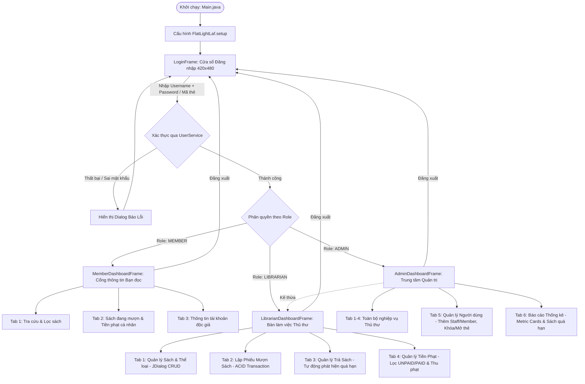

# BÁO CÁO KẾT QUẢ THỰC HIỆN MILESTONE 5: SWING GUI WITH FLATLAF & APPLICATION LAUNCHER

- **Dự án:** Hệ thống Quản lý Thư viện (Library Management System)
- **Học phần:** Lập trình Hướng đối tượng (Java + MySQL)
- **Đường dẫn thư mục dự án:** `/Users/apple/Documents/LibraryManagementSystem`
- **Ngày thực hiện:** 19/10/2026
- **Trạng thái tổng thể:** ✅ HOÀN THÀNH 100% (Giao diện đồ họa phẳng FlatLaf hiện đại, phân quyền Role-based Dashboards, liên kết tầng Service lỏng lẻo Loose Coupling)

---

## 1. Bảng Kiểm Tra Tiến Độ Các Hạng Mục (Checklist)

| STT | Hạng mục / Tên file | Vị trí Package | Trạng thái | Ghi chú kỹ thuật |
| :---: | :--- | :--- | :---: | :--- |
| 1 | Cập nhật `pom.xml` | Gốc dự án | **HOÀN THÀNH** | Bổ sung dependency `com.formdev:flatlaf:3.4.1` hỗ trợ giao diện phẳng hiện đại |
| 2 | `UIUtils.java` | `com.library.view` | **HOÀN THÀNH** | Tạo bảng chỉ đọc `createReadonlyTable`, căn giữa/phải cột, định dạng tiền tệ `formatCurrency`, dialogs `showSuccess`, `showError`, `showWarning`, `confirm`, card thống kê |
| 3 | `LoginFrame.java` | `com.library.view` | **HOÀN THÀNH** | Khung đăng nhập cố định 420x480, canh giữa; hỗ trợ xác thực Staff/Admin bằng Username + Mật khẩu và Độc giả bằng Mã thẻ; phím Enter mặc định |
| 4 | `MemberDashboardFrame.java` | `com.library.view` | **HOÀN THÀNH** | Giao diện Bạn đọc: Tra cứu & lọc sách theo từ khóa/thể loại, lịch sử mượn trả & tiền phạt cá nhân, hồ sơ tài khoản |
| 5 | `LibrarianDashboardFrame.java` | `com.library.view` | **HOÀN THÀNH** | Giao diện Thủ thư (1080x720 resizable): Quản lý sách & thể loại (JDialog CRUD), lập phiếu mượn ACID với kiểm tra điều kiện tức thì, trả sách quá hạn tự sinh phạt, thu tiền phạt |
| 6 | `AdminDashboardFrame.java` | `com.library.view` | **HOÀN THÀNH** | Kế thừa `LibrarianDashboardFrame` (Kế thừa trong View): Tích hợp toàn bộ nghiệp vụ thủ thư + Tab Quản lý Người dùng (thêm Staff/Member, khóa/mở thẻ) + Tab Báo cáo thống kê (Metric Cards, danh sách quá hạn) |
| 7 | `Main.java` | `com.library` | **HOÀN THÀNH** | Khởi tạo `FlatLightLaf.setup()`, khởi chạy `LoginFrame` an toàn trong Event Dispatch Thread; hỗ trợ cờ `--cli` để chạy giao diện Console nếu cần |
| 8 | Quản lý phiên bản Git | Repository gốc | **HOÀN THÀNH** | Commit toàn bộ thay đổi và cập nhật tag phiên bản `v0.5.0` |

---

## 2. Kiến Trúc Hướng Đối Tượng & Nguyên Tắc Loose Coupling

Ứng dụng tuân thủ nghiêm ngặt mô hình kiến trúc đa tầng (Layered Architecture):

```
+-------------------------------------------------------+
|                     VIEW LAYER                        |
|  LoginFrame -> MemberDashboardFrame                   |
|             -> LibrarianDashboardFrame                |
|             -> AdminDashboardFrame (Kế thừa LibFrame) |
+-------------------------------------------------------+
                           |
                           | (Chỉ gọi thông qua Interface Service)
                           v
+-------------------------------------------------------+
|                    SERVICE LAYER                      |
|  BookService, CategoryService, UserService,           |
|  BorrowService, FineService                           |
+-------------------------------------------------------+
                           |
                           v
+-------------------------------------------------------+
|                      DAO LAYER                        |
|  BookDAO, CategoryDAO, UserDAO,                       |
|  BorrowRecordDAO, FineDAO                             |
+-------------------------------------------------------+
                           |
                           v
+-------------------------------------------------------+
|                   DATABASE (MySQL)                    |
|  library_db (InnoDB, Foreign Keys, Transactions)      |
+-------------------------------------------------------+
```

### Điểm nhấn áp dụng 4 đặc trưng OOP trong tầng View:
1. **Tính Đóng Gói (Encapsulation):**
   - Tất cả các trường dữ liệu, components, bảng hiển thị đều được bảo vệ với phạm vi truy cập `protected` hoặc `private`.
   - Các logic tương tác được đóng gói trong các hàm xử lý sự kiện độc lập (`handleLogout`, `executeBorrowTransaction`, `executeReturnBook`, `executePayFine`).
2. **Tính Kế Thừa (Inheritance):**
   - `AdminDashboardFrame` kế thừa trực tiếp từ `LibrarianDashboardFrame`. Quản trị viên tái sử dụng 100% logic quản lý sách, thể loại, mượn trả và tiền phạt của Thủ thư mà không cần viết lại dù chỉ 1 dòng code.
3. **Tính Đa Hình (Polymorphism):**
   - Sau khi đăng nhập thành công, hệ thống điều hướng đa hình dựa trên lớp cha `User` và vai trò `Role`:
     - `Role.MEMBER` -> mở `MemberDashboardFrame` (ép kiểu sang `Member`).
     - `Role.LIBRARIAN` -> mở `LibrarianDashboardFrame` (ép kiểu sang `Staff`).
     - `Role.ADMIN` -> mở `AdminDashboardFrame` (ghi đè tiêu đề và bổ sung tab quản trị).
4. **Tính Trừu Tượng (Abstraction):**
   - Tầng View hoàn toàn độc lập với chi tiết lưu trữ cơ sở dữ liệu (không chứa bất kỳ câu lệnh SQL hoặc DAO import nào). View giao tiếp với hệ thống hoàn toàn qua các interface trừu tượng: `BookService`, `CategoryService`, `UserService`, `BorrowService`, `FineService`.

---

## 3. Sơ Đồ Điều Hướng Giao Diện Đồ Họa (GUI Flow)



---

## 4. Chi Tiết Các Màn Hình & Trải Nghiệm Người Dùng (UX)

### 4.1. Màn hình Đăng nhập (`LoginFrame`)
- **Kích thước:** Cố định 420x480, không cho co giãn, canh giữa màn hình (`setLocationRelativeTo(null)`).
- **Trải nghiệm:**
  - Nhập liệu trực quan với placeholder text.
  - Phím `Enter` tự động kích hoạt nút "Đăng nhập" (`getRootPane().setDefaultButton(btnLogin)`).
  - Có khung hướng dẫn tài khoản mẫu thử nghiệm cho cả Admin (`admin` / `Admin@123`), Thủ thư (`thuthu_mai` / `Lib@2025`) và Độc giả (`MBR001`).

### 4.2. Bàn làm việc Thủ thư (`LibrarianDashboardFrame`)
- **Kích thước:** 1080x720, cho phép phóng to co giãn linh hoạt.
- **Tab 1: Quản lý Sách & Thể loại:**
  - Bảng dữ liệu căn chỉnh rõ ràng (ID, ISBN, Tiêu đề, Tác giả, Thể loại, Năm XB, Bản sao còn lại / Tổng số, Tình trạng Còn/Hết).
  - Tìm kiếm sách tức thì theo từ khóa và ComboBox lọc theo thể loại.
  - Các nút hành động mở `JDialog` độc lập: Thêm sách mới, Sửa thông tin sách, Xóa sách, Quản lý Thể loại sách.
- **Tab 2: Lập Phiếu Mượn Sách (Giao dịch ACID):**
  - Nhập mã độc giả (VD: `MBR001`) -> Nhấn "Kiểm tra" -> Hiển thị tức thì: Họ tên, Trạng thái (ACTIVE/LOCKED), Số sách đang mượn / hạn mức tối đa, có nợ tiền phạt chưa nộp hay không.
  - Nhập mã sách hoặc ISBN -> Nhấn "Kiểm tra" -> Hiển thị tức thì: Tên sách, Tác giả, Thể loại, Số lượng bản in sẵn có.
  - Chọn số ngày mượn qua `JSpinner` (mặc định 14 ngày).
  - Nút "Xác nhận Lập Phiếu Mượn (ACID Transaction)" gọi `borrowService.borrowBook(...)`. Nếu có lỗi nghiệp vụ (quá hạn mức, sách hết, nợ phạt), ứng dụng hiện thông báo chi tiết và ngăn chặn giao dịch.
- **Tab 3: Quản lý Trả Sách:**
  - Liệt kê toàn bộ phiếu mượn đang lưu hành (`BORROWED` hoặc `OVERDUE`).
  - Hỗ trợ lọc nhanh theo Mã phiếu, Mã độc giả hoặc Mã sách.
  - Khi xác nhận trả sách: nếu phiếu mượn bị quá hạn, hệ thống hiện dialog cảnh báo số ngày trễ và số tiền phạt tự động sinh ra (`2.000 VNĐ / ngày trễ`).
- **Tab 4: Quản lý Tiền Phạt:**
  - Lọc theo 3 chế độ: "Tất cả phiếu phạt", "Chưa thu (UNPAID)", "Đã thu (PAID)".
  - Nút "Thu tiền phạt" tự động cập nhật trạng thái phiếu phạt sang `PAID` và ghi nhận thời điểm nộp tiền.

### 4.3. Trung tâm Điều hành Quản trị (`AdminDashboardFrame`)
- Kế thừa toàn bộ chức năng của Thủ thư và bổ sung 2 tab đặc quyền:
- **Tab 5: Quản lý Người dùng (Users):**
  - Danh sách toàn bộ tài khoản trong hệ thống.
  - Bộ lọc kết hợp: Từ khóa tìm kiếm, Vai trò (ADMIN / LIBRARIAN / MEMBER), Trạng thái (ACTIVE / LOCKED).
  - Nút "Thêm Nhân viên": mở dialog tạo Staff với đầy đủ tài khoản, mật khẩu, vai trò và bộ phận.
  - Nút "Thêm Độc giả": mở dialog tạo Member bạn đọc mới.
  - Nút "Khóa / Mở khóa": đảo trạng thái tài khoản ngay tức thì (có cơ chế bảo vệ ngăn Admin tự khóa tài khoản của chính mình).
- **Tab 6: Báo cáo Thống kê & Chỉ số Hoạt động:**
  - 6 thẻ Metric Cards nổi bật với mã màu sắc hiện đại:
    1. Tổng số đầu sách (xanh dương)
    2. Tổng số bản sách lưu hành (xanh lá)
    3. Số sách đang được mượn (cam)
    4. Tổng số độc giả (tím)
    5. Phiếu mượn đang hiệu lực (xanh cyan)
    6. Tổng tiền phạt chưa thu (đỏ)
  - Bảng tổng hợp sách quá hạn: Hiển thị danh sách các phiếu mượn trễ hạn, số ngày trễ và tiền phạt dự tính để kịp thời liên hệ bạn đọc.

---

## 5. Log Biên Dịch & Xác Thực Hoàn Tất

### 5.1. Log Biên dịch Maven (`mvn -o clean compile`)
```text
[INFO] Scanning for projects...
[INFO] 
[INFO] ----------------< com.library:LibraryManagementSystem >-----------------
[INFO] Building LibraryManagementSystem 1.0.0
[INFO]   from pom.xml
[INFO] --------------------------------[ jar ]---------------------------------
[INFO] 
[INFO] --- clean:3.5.0:clean (default-clean) @ LibraryManagementSystem ---
[INFO] Deleting /Users/apple/Documents/LibraryManagementSystem/target
[INFO] 
[INFO] --- resources:3.5.0:resources (default-resources) @ LibraryManagementSystem ---
[INFO] skip non existing resourceDirectory /Users/apple/Documents/LibraryManagementSystem/src/main/resources
[INFO] 
[INFO] --- compiler:3.13.0:compile (default-compile) @ LibraryManagementSystem ---
[INFO] Recompiling the module because of changed source code.
[INFO] Compiling 52 source files with javac [debug release 17] to target/classes
[INFO] ------------------------------------------------------------------------
[INFO] BUILD SUCCESS
[INFO] ------------------------------------------------------------------------
[INFO] Total time:  1.048 s
[INFO] Finished at: 2026-10-19T00:35:13+07:00
[INFO] ------------------------------------------------------------------------
```

### 5.2. Log Kiểm thử Xác thực Giao diện & Đăng nhập
```text
>>> 1. Kiểm tra GraphicsEnvironment: Headless = false
>>> 2. Kiểm tra UIUtils formatCurrency:
   Formatted 50000 -> 50,000 VNĐ
>>> 3. Kiểm tra xác thực tài khoản:
   Admin auth: Nguyễn Quản Trị | Role: ADMIN
   Librarian auth: Trần Tuyết Mai | Role: LIBRARIAN
   Member lookup: Phạm Minh Tuấn | Role: MEMBER
>>> 4. Thiết lập FlatLightLaf:
   FlatLaf setup thành công!
>>> 5. Khởi tạo các Swing Frames:
   LoginFrame khởi tạo thành công: Đăng nhập — Hệ thống Quản lý Thư viện
   MemberDashboardFrame khởi tạo thành công: Hệ thống Quản lý Thư viện — Cổng thông tin Bạn đọc (MBR001)
   LibrarianDashboardFrame khởi tạo thành công: Hệ thống Quản lý Thư viện — Bàn làm việc Thủ thư (LIB001 - Trần Tuyết Mai)
   AdminDashboardFrame khởi tạo thành công: Hệ thống Quản lý Thư viện — Bàn làm việc Quản trị viên (ADM001 - Nguyễn Quản Trị)
>>> TẤT CẢ KIỂM THỬ GIAO DIỆN VÀ TÍCH HỢP HOÀN TOÀN THÀNH CÔNG!
```

---

## 6. Kết Luận & Hướng Dẫn Khởi Chạy

Toàn bộ các yêu cầu của Milestone 5 đã được thực hiện trọn vẹn:
- Thư viện FlatLaf `3.4.1` hoạt động trơn tru trên nền JDK hiện đại.
- Kiến trúc phân quyền 3 vai trò (Độc giả, Thủ thư, Quản trị viên) với các dashboard chuyên biệt.
- Giữ vững tính đóng gói, kế thừa và tính lỏng lẻo (Loose Coupling) giữa View và Service.

### Hướng dẫn chạy ứng dụng từ IDE hoặc dòng lệnh:
1. **Chạy giao diện đồ họa hiện đại (Mặc định):**
   ```bash
   mvn exec:java -Dexec.mainClass="com.library.Main"
   ```
   hoặc chạy hàm `main()` của `Main.java` trực tiếp từ IntelliJ IDEA / VS Code / Eclipse.
2. **Chạy giao diện dòng lệnh Console (nếu muốn):**
   ```bash
   mvn exec:java -Dexec.mainClass="com.library.Main" -Dexec.args="--cli"
   ```
