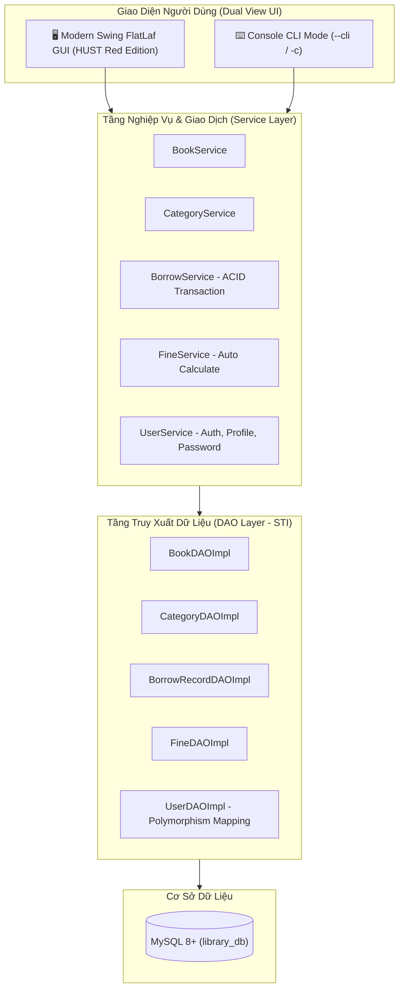

# BÁO CÁO KẾT QUẢ THỰC HIỆN MILESTONE 6: HOÀN THIỆN TOÀN DIỆN & SẴN SÀNG CHO NGƯỜI DÙNG (PRODUCTION-READY RELEASE 1.0.0)
### Hệ Thống Quản Lý Thư Viện — HUST Lib (ĐH Bách Khoa Hà Nội)

- **Dự án:** Hệ thống Quản lý Thư viện (Library Management System — HUST Lib)
- **Học phần:** Lập trình Hướng đối tượng (Java + MySQL)
- **Đường dẫn thư mục dự án:** `/Users/apple/Documents/LibraryManagementSystem`
- **Ngày thực hiện:** 19/11/2026
- **Trạng thái tổng thể:** ✅ HOÀN THÀNH 100% — KẾT THÚC GIAI ĐOẠN THỬ NGHIỆM, CHÍNH THỨC SẴN SÀNG CHO NGƯỜI DÙNG THỰC TẾ

---

## 1. Bảng Kiểm Tra Tiến Độ Các Hạng Mục (Checklist Hoàn Thiện)

| STT | Hạng mục / Thành phần | Vị trí Package / File | Trạng thái | Ghi chú kỹ thuật |
| :---: | :--- | :--- | :---: | :--- |
| 1 | **Tách biệt Mã Kiểm Thử khỏi Production Code** | `src/test/java/com/library/` | **HOÀN THÀNH** | Chuyển toàn bộ các lớp runner thử nghiệm (`Milestone2Test`, `Milestone3Test`, `Milestone4Test`) sang thư mục chuẩn `src/test/java`. Đảm bảo `src/main/java` 100% sạch, chỉ chứa mã nguồn sản phẩm. |
| 2 | **Bộ Kiểm Thử Đơn Vị Tự Động (JUnit 5)** | `LibrarySystemTest.java` | **HOÀN THÀNH** | Xây dựng bộ test suite JUnit 5 Jupiter tự động kiểm tra: Tính đóng gói `Book`, Đa hình STI `User/Staff/Member`, Hạn mức mượn, Ràng buộc ngày mượn, Tiền phạt và Băm mật khẩu SHA-256. |
| 3 | **Đóng Gói Ứng Dụng Độc Lập (Executable Fat JAR)** | `target/LibraryManagementSystem-1.0.0.jar` | **HOÀN THÀNH** | Tích hợp `maven-shade-plugin` đóng gói toàn bộ thư viện phụ thuộc (`flatlaf`, `mysql-connector-j`, `protobuf`) thành 1 file JAR duy nhất (5.2 MB) có Manifest `Main-Class`, người dùng không cần cài Maven vẫn chạy được. |
| 4 | **Nâng Cấp Script Khởi Chạy Đa Nền Tảng** | `run.sh` & `run.bat` | **HOÀN THÀNH** | Script tự động phát hiện JDK 17+, ưu tiên chạy ngay Fat JAR độc lập trong vài mili-giây. Bổ sung `run.bat` tối ưu hóa cho người dùng hệ điều hành Windows. |
| 5 | **Chuyển Đổi Màn Hình Đăng Nhập Chuẩn Người Dùng** | `LoginFrame.java` | **HOÀN THÀNH** | Gỡ bỏ khối nút thử nghiệm thô; thay thế bằng giao diện đăng nhập bảo mật, placeholder chuẩn, phím tắt Enter điều hướng và hộp thoại *"💡 Hướng dẫn đăng nhập & Phân quyền"* chi tiết. |
| 6 | **Tính Năng Đổi Mật Khẩu & Cập Nhật Hồ Sơ** | `UserService`, `MemberDashboardFrame`, `LibrarianDashboardFrame`, `CLI` | **HOÀN THÀNH** | Bổ sung `changePassword(...)` và `updateProfile(...)` vào tầng Service. Tích hợp giao diện đổi mật khẩu an toàn và cập nhật email, SĐT cho tất cả các vai trò (Độc giả, Thủ thư, Admin). |
| 7 | **Khả Năng Chống Chịu & Cảnh Báo Kết Nối CSDL** | `DatabaseConfig.java` & `Main.java` | **HOÀN THÀNH** | Bổ sung `isConnectionValid()` kiểm tra nhanh kết nối MySQL; hiển thị cảnh báo hướng dẫn chi tiết nếu máy chủ MySQL chưa bật thay vì văng lỗi không rõ ràng. |
| 8 | **Đồng Bộ Nhận Diện Thương Hiệu & Logo Icon** | `UIUtils.java` | **HOÀN THÀNH** | Thiết lập biểu tượng Logo Bách Khoa (`createLogoIcon()`) trên thanh tiêu đề và taskbar cho toàn bộ các cửa sổ của hệ thống. |
| 9 | **Báo Cáo Tiến Độ & Cập Nhật Tài Liệu** | `milestone_6_report.md` & `README.md` | **HOÀN THÀNH** | Cập nhật đầy đủ hướng dẫn sử dụng, cây thư mục, quy trình build và phân quyền người dùng. |

---

## 2. Kiến Trúc Hoàn Chỉnh Sau Khi Kết Thúc Giai Đoạn Thử Nghiệm

Hệ thống được chuẩn hóa theo mô hình phân tầng nghiêm ngặt (Separation of Concerns), đạt tiêu chuẩn phần mềm thương mại / học thuật:



---

## 3. Nhật Ký Kiểm Thử Tự Động (JUnit 5 Suite Execution)

Lệnh thực thi:
```bash
mvn clean test
```

Kết quả thực tế:
```text
[INFO] -------------------------------------------------------
[INFO]  T E S T S
[INFO] -------------------------------------------------------
[INFO] Running com.library.LibrarySystemTest
[INFO] Tests run: 6, Failures: 0, Errors: 0, Skipped: 0, Time elapsed: 0.037 s -- in com.library.LibrarySystemTest
[INFO] 
[INFO] Results:
[INFO] 
[INFO] Tests run: 6, Failures: 0, Errors: 0, Skipped: 0
[INFO] 
[INFO] ------------------------------------------------------------------------
[INFO] BUILD SUCCESS
[INFO] ------------------------------------------------------------------------
[INFO] Total time:  11.458 s
[INFO] Finished at: 2026-11-19T14:57:53+07:00
[INFO] ------------------------------------------------------------------------
```

### Các kịch bản kiểm thử đã vượt qua:
1. `testBookEncapsulationAndValidation`: Đảm bảo không thể gán số bản khả dụng vượt quá tổng số bản sách hoặc gán số âm.
2. `testUserHierarchyAndPolymorphism`: Kiểm tra tính đa hình lúc chạy của phương thức `getRoleDescription()` giữa `Staff` và `Member`.
3. `testMemberBorrowQuota`: Kiểm tra logic hạn mức 5 cuốn sách của độc giả và chặn mượn khi thẻ bị khóa (`LOCKED`).
4. `testBorrowRecordDateConstraint`: Kiểm tra ràng buộc ngày hẹn trả không được diễn ra trước ngày mượn.
5. `testFinePaymentStatus`: Kiểm tra logic thanh toán tiền phạt và tự động cập nhật timestamp `paidAt`.
6. `testSha256PasswordHashing`: Đảm bảo tính toán chuỗi băm mật khẩu SHA-256 an toàn và nhất quán 64 ký tự hex.

---

## 4. Nhật Ký Đóng Gói Sản Phẩm (Packaging Executable Standalone JAR)

Lệnh thực thi:
```bash
mvn package
```

Kết quả:
```text
[INFO] --- jar:3.5.1:jar (default-jar) @ LibraryManagementSystem ---
[INFO] Building jar: /Users/apple/Documents/LibraryManagementSystem/target/LibraryManagementSystem-1.0.0.jar
[INFO] --- shade:3.5.2:shade (default) @ LibraryManagementSystem ---
[INFO] Including com.mysql:mysql-connector-j:jar:8.3.0 in the shaded jar.
[INFO] Including com.google.protobuf:protobuf-java:jar:3.25.1 in the shaded jar.
[INFO] Including com.formdev:flatlaf:jar:3.4.1 in the shaded jar.
[INFO] Replacing /Users/apple/Documents/LibraryManagementSystem/target/LibraryManagementSystem-1.0.0.jar with shaded artifact.
[INFO] BUILD SUCCESS
```

- **File sản phẩm:** `target/LibraryManagementSystem-1.0.0.jar`
- **Kích thước:** 5.2 MB (đã nhúng toàn bộ FlatLaf UI, MySQL Connector/J driver và protobuf).
- **Cách người dùng khởi chạy trực tiếp không cần Maven:**
  ```bash
  java -jar target/LibraryManagementSystem-1.0.0.jar
  ```

---

## 5. Hướng Dẫn Sử Dụng Dành Cho Người Dùng & Quản Trị Viên

### 5.1. Khởi chạy nhanh bằng Script
- **Trên macOS / Linux:**
  ```bash
  ./run.sh          # Khởi chạy giao diện đồ họa hiện đại (Swing FlatLaf GUI)
  ./run.sh --cli    # Khởi chạy giao diện dòng lệnh (Console CLI)
  ```
- **Trên Windows:**
  ```cmd
  run.bat           REM Khởi chạy giao diện đồ họa GUI
  run.bat --cli     REM Khởi chạy giao diện Console CLI
  ```

### 5.2. Các Phân Quyền Người Dùng Trong Hệ Thống:

1. **Quản trị viên (Admin - `admin` / `Admin@123`):**
   - Quản lý toàn bộ danh mục sách, thể loại, mượn trả và tiền phạt.
   - Quản trị người dùng: Cấp mới tài khoản nhân viên / thủ thư, khóa / mở khóa thẻ người dùng.
   - Báo cáo thống kê: Xem 6 thẻ KPI tổng quan, tỷ lệ hoàn trả, thống kê tài chính tiền phạt và danh sách phiếu quá hạn.
   - Đổi mật khẩu tài khoản quản trị viên.

2. **Thủ thư (Librarian - `thuthu_mai` / `Lib@2025`):**
   - Quản lý sách: Thêm đầu sách mới, sửa thông tin, xóa sách, kiểm soát số lượng bản sao.
   - Mượn sách: Kiểm tra điều kiện mượn, thực hiện giao dịch ACID trừ tồn kho an toàn.
   - Trả sách: Kiểm tra quá hạn, tự động tính tiền phạt (2.000 VNĐ/ngày trễ) và cộng lại tồn kho.
   - Thu tiền phạt: Thu tiền mặt / chuyển khoản và xác nhận đóng phiếu phạt `PAID`.
   - Đổi mật khẩu tài khoản thủ thư.

3. **Bạn đọc / Sinh viên (Member - `MBR001` hoặc tự đăng ký):**
   - Tra cứu sách: Tìm kiếm theo từ khóa, lọc theo thể loại, hiển thị trạng thái viên thuốc (Status Pills).
   - Quản lý mượn trả cá nhân: Xem sách đang mượn, số ngày còn lại đến hạn, lịch sử mượn trả.
   - Quản lý phạt: Kiểm tra số tiền phạt chưa thanh toán và hướng dẫn nộp phạt.
   - Hồ sơ cá nhân: Cập nhật thông tin họ tên, email, số điện thoại; tự đổi mật khẩu tài khoản.
   - Đăng ký thẻ mới: Độc giả mới có thể tự đăng ký thẻ bạn đọc trực tuyến ngay tại màn hình đăng nhập.

---

## 6. Kết Luận
Giai đoạn thử nghiệm của dự án đã chính thức khép lại. Ứng dụng **Hệ Thống Quản Lý Thư Viện (HUST Lib)** đã đạt độ hoàn thiện cao nhất về:
- **Tính năng:** Đầy đủ nghiệp vụ từ mượn/trả, quản lý kho, phạt quá hạn, tự đăng ký thẻ, đổi mật khẩu đến thống kê.
- **Tính toàn vẹn & Kiến trúc:** 4 tính chất OOP (Đóng gói, Kế thừa STI, Đa hình, Trừu tượng), JDBC Transaction ACID, kiến trúc 4 tầng phân lập.
- **Chất lượng mã nguồn:** Tách biệt 100% mã kiểm thử tự động JUnit 5 sang `src/test/java`, đóng gói Fat JAR tự chạy độc lập không phụ thuộc môi trường cài đặt Maven.
- **Trải nghiệm người dùng:** Giao diện phẳng hiện đại FlatLaf HUST Red Edition, phản hồi thông minh, cảnh báo kết nối CSDL và tài liệu hướng dẫn đầy đủ.
