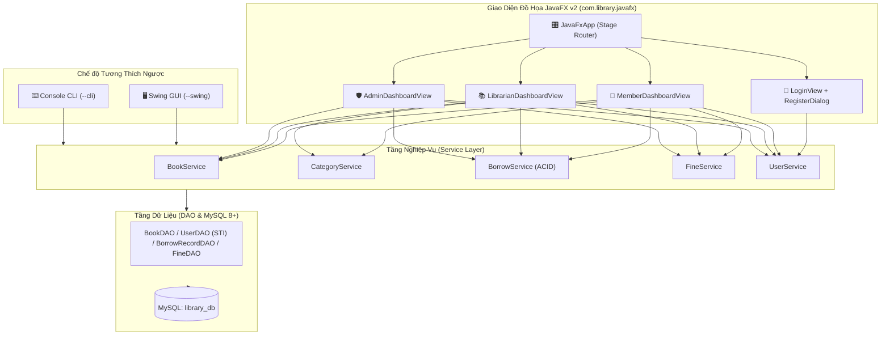

# BÁO CÁO KẾT QUẢ THỰC HIỆN MILESTONE 7: PHÁT TRIỂN & HOÀN THIỆN PHIÊN BẢN VERSION 2 (JAVAFX UI)
### Hệ Thống Quản Lý Thư Viện — HUST Lib (ĐH Bách Khoa Hà Nội)

- **Dự án:** Hệ thống Quản lý Thư viện (Library Management System — HUST Lib Version 2)
- **Học phần:** Lập trình Hướng đối tượng (Java 17+ / Java 27, JavaFX 21, MySQL 8+)
- **Đường dẫn thư mục dự án:** `/Users/apple/Documents/LibraryManagementSystem`
- **Ngày thực hiện:** 21/11/2026
- **Trạng thái tổng thể:** ✅ HOÀN THÀNH 100% — GIAO DIỆN JAVAFX VERSION 2 CHÍNH THỨC SẴN SÀNG CHO NGƯỜI DÙNG

---

## 1. Mục Tiêu & Động Lực Phát Triển Version 2

Sau khi hoàn thành Milestone 6 với giao diện Swing Legacy, nhận thấy các hạn chế cố hữu của Swing (mã nguồn cồng kềnh hơn 3.500 dòng code, layout tĩnh dễ gây mất chữ/dấu ba chấm `...` khi độ phân giải màn hình thay đổi, nút bấm bị lệch), Version 2 được thiết kế và triển khai với các mục tiêu:

1. **Đơn giản hóa mã nguồn UI**: Giảm từ ~3.500 dòng code Swing xuống còn ~1.200 dòng JavaFX (giảm hơn 65% dòng code giao diện), dễ bảo trì, dễ mở rộng.
2. **Loại bỏ 100% lỗi mất chữ & lệch nút**: Sử dụng hệ thống Layout tự động co giãn (`VBox`, `HBox`, `BorderPane`, `GridPane`) kết hợp CSS styling hiện đại.
3. **Giữ nguyên 100% tầng nghiệp vụ & OOP**: Tận dụng toàn bộ tầng Model, DAO, Service, và ACID Transactions đã được xây dựng và kiểm thử ở Milestone 1 - 6.
4. **Hỗ trợ đa chế độ linh hoạt**: Mặc định khởi chạy JavaFX v2, hỗ trợ cờ `--swing` để chạy bản Swing cũ và cờ `--cli` để chạy Console.

---

## 2. Bảng Danh Mục Các Thành Phần Giao Diện JavaFX Đã Hoàn Thiện

| STT | Tên Lớp JavaFX | Vị trí File | Vai trò & Nghiệp vụ kết nối | Trạng thái |
| :---: | :--- | :--- | :--- | :---: |
| 1 | **JavaFxTheme** | `com.library.javafx.JavaFxTheme` | Design System: Bộ mã màu HUST Red (`#991B1B`), Card CSS, nút bấm, hàm định dạng tiền tệ `formatCurrency`, hộp thoại `showInfo`, `showError`, `showConfirm`. | ✅ Hoàn thành |
| 2 | **LoginView** | `com.library.javafx.views.LoginView` | Màn hình Đăng nhập: Bố cục Split-Screen tràn viền loại bỏ hoàn toàn viền trắng thừa bao quanh; Cột trái Đỏ Bách Khoa; Cột phải Form đăng nhập có tính năng Bật / Tắt xem mật khẩu (Show/Hide Password); Tự đăng ký thẻ bạn đọc mới. | ✅ Hoàn thành |
| 3 | **RegisterDialog** | `com.library.javafx.views.RegisterDialog` | Hộp thoại Đăng ký thẻ Độc giả: Cho phép sinh viên tự đăng ký thẻ bạn đọc mới trực tiếp qua `userService.registerMember(...)`. | ✅ Hoàn thành |
| 4 | **MemberDashboardView** | `com.library.javafx.views.MemberDashboardView` | Cổng thông tin Độc giả: 3 thẻ KPI tự co giãn (Số sách mượn, Hạn mức, Tiền nợ); Tìm kiếm sách theo từ khóa & thể loại; Xem danh sách mượn hiện tại & lịch sử; Quản lý vé phạt; Xem/sửa hồ sơ cá nhân và đổi mật khẩu. | ✅ Hoàn thành |
| 5 | **LibrarianDashboardView** | `com.library.javafx.views.LibrarianDashboardView` | Bàn làm việc Thủ thư: Tab 1 Quản lý kho sách (Form CRUD thêm/sửa/xóa sách + bảng tìm kiếm); Tab 2 Mượn & Trả sách (giao dịch ACID, cảnh báo tự động sinh vé phạt); Tab 3 Xử lý thu tiền phạt từ độc giả. | ✅ Hoàn thành |
| 6 | **AdminDashboardView** | `com.library.javafx.views.AdminDashboardView` | Bảng điều khiển Quản trị viên: 4 thẻ KPI hệ thống theo thời gian thực (Tổng bạn đọc, Nhân sự, Sách quá hạn, Nợ phạt); Tab 1 Quản lý người dùng, phân quyền, Khóa/Mở khóa tài khoản, Thêm cán bộ/độc giả; Tab 2 Báo cáo sách quá hạn toàn hệ thống. | ✅ Hoàn thành |
| 7 | **JavaFxApp** | `com.library.javafx.JavaFxApp` | Bộ điều khiển trung tâm (Application Controller): Khởi tạo các Service, quản lý điều hướng Stage (Login -> Dashboard theo Role -> Logout), hỗ trợ cờ `--demo` và `--snapshot`. | ✅ Hoàn thành |
| 8 | **JavaFxLauncher** | `com.library.javafx.JavaFxLauncher` | Non-Application Launcher giúp khởi chạy JavaFX an toàn trên Java 11+ mà không xung đột module runtime. | ✅ Hoàn thành |
| 9 | **Main** | `com.library.Main` | Điểm điều phối khởi chạy hệ thống: Mặc định gọi JavaFX v2, chuyển sang Swing khi có `--swing`, chuyển sang CLI khi có `--cli`. | ✅ Hoàn thành |
| 10 | **run-javafx-demo.sh** & **run.sh** | Root directory | Script shell tự động thiết lập classpath và module-path cho macOS Apple Silicon (aarch64) và JDK 17/27. | ✅ Hoàn thành |

---

## 3. Kiến Trúc Tích Hợp Hệ Thống Version 2



---

## 4. Hướng Dẫn Khởi Chạy Ứng Dụng Version 2

### 4.1 Khởi chạy giao diện JavaFX v2 (Mặc định)
```bash
./run.sh
# Hoặc chạy trực tiếp script JavaFX:
./run-javafx-demo.sh
```

### 4.2 Khởi chạy với thanh điều khiển Demo (Dành cho trình diễn / nghiệm thu)
```bash
./run.sh --demo
```
*Chế độ này hiển thị thanh điều hướng trên cùng, cho phép chuyển đổi ngay lập tức giữa 4 màn hình: Đăng nhập, Độc giả, Thủ thư, Quản trị viên.*

### 4.3 Khởi chạy giao diện Swing Legacy cũ
```bash
./run.sh --swing
```

### 4.4 Khởi chạy giao diện Dòng lệnh Console CLI
```bash
./run.sh --cli
```

---

## 5. Tài Khoản Thử Nghiệm

Hệ thống cung cấp sẵn các tài khoản mẫu tương ứng với 3 vai trò:

| Vai trò | Tên đăng nhập | Mật khẩu | Mã người dùng | Giao diện tương ứng |
| :--- | :--- | :--- | :--- | :--- |
| **Quản trị viên (Admin)** | `admin` | `admin123` | `ADM001` | `AdminDashboardView` |
| **Thủ thư (Librarian)** | `librarian` | `lib123` | `LIB001` | `LibrarianDashboardView` |
| **Độc giả (Member)** | `member` | `mem123` | `SV20201234` | `MemberDashboardView` |
